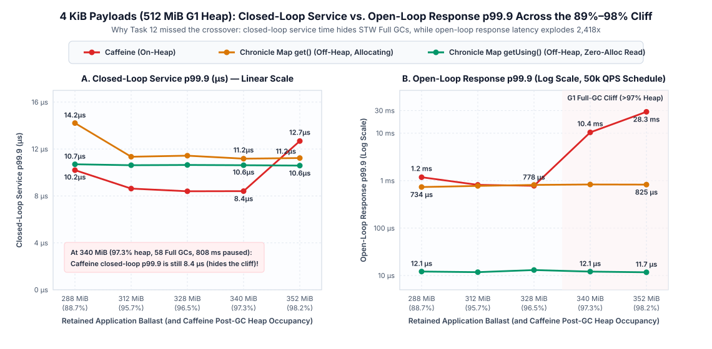
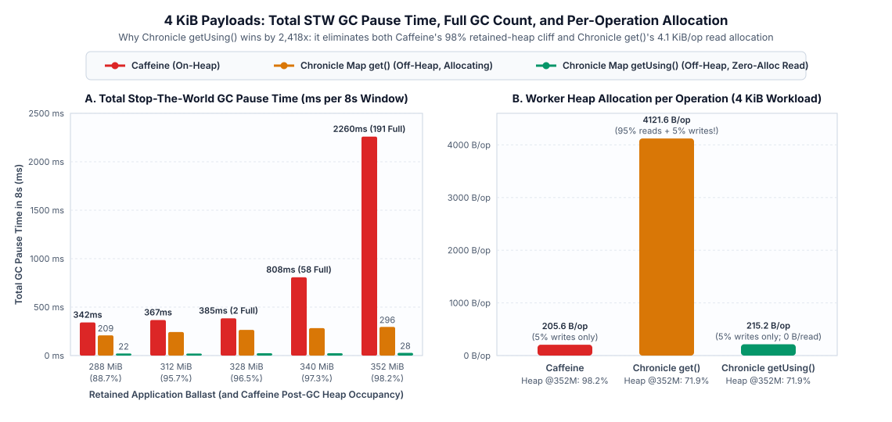
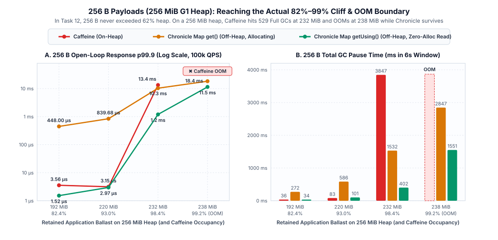

# TailCache

TailCache is a Java 21 benchmark experiment comparing tail latency in Caffeine
(on heap) and in-memory Chronicle Map (off heap). The harness runs controlled
workloads and records per-fork latency distributions, allocation, and garbage
collection. It also supports separate diagnostics for file-backed Chronicle Map.

## Experiment questions and results

| Question | Result under the tested settings |
| --- | --- |
| **RQ1.** Does added application data cause a crossover in ordinary service p99 or p99.9? | No robust pressure-induced crossover was observed. Caffeine led at 4 KiB throughout the tested saturated-service matrix. |
| **RQ2.** Does the value size change the service-latency ranking? | At p99 and p99.9, Chronicle led at 256 B and Caffeine led at 4 KiB. This comparison covers one cache worker and the tested cache settings. |
| **RQ3.** Can the set of keys eligible for writes reverse scheduled-response p99.9 at the same write rate? | At 4 KiB, 5% writes, and 50,000 intended arrivals/s, Caffeine led with 2,048 eligible write keys and Chronicle led with all 32,768. The reversal repeated on two hosts and held at 100,000 arrivals/s on the second host with roughly 2,500 writes/s. |

Service latency measures the time to perform a benchmark operation, including
fresh value construction on writes. Scheduled response measures from the intended
arrival through completion, including time spent waiting for the worker. At 10% and 20% writes in the follow-up, Chronicle
led with the full write set and the concentrated pairs were mixed.

[Second-host results](https://github.com/Enixes/TailCache/tree/4c3ab6794643febf676d91446f80b9724517ff74/docs/second-host-20261120) · [Pop!_OS follow-up](https://github.com/Enixes/TailCache/tree/codex/tailcache-portability/docs/nov23-popos-followup) · [Interactive results](https://github.com/Enixes/TailCache/blob/codex/tailcache-preprint/output/html/tailcache-preprint-reader.html) · [Experiment status](https://github.com/Enixes/TailCache/blob/codex/tailcache-preprint/docs/TAILCACHE_CURRENT_STATE.md)

## Reproduce the experiment

Check out `codex/tailcache-portability` and use Java 21 and Python 3.10+.
The [portable collection guide](https://github.com/Enixes/TailCache/blob/codex/tailcache-portability/docs/PORTABLE_EXPERIMENT.md) lists the Gradle commands, suite options,
and steps to verify retained results.

## Original Task 12 heap-pressure campaign

**Status (8 November 2026):** complete as an **observer-conditional study**. The original unconditional protocol is **NO_GO**. The study does not show a crossover, and it does not rule one out either. Authoritative sources: [final experiment review](docs/TAILCACHE_12_FINAL_OUTCOME_REVIEW.md), [acceptance manifest](docs/TAILCACHE_12_FINAL_ACCEPTANCE.json), [status](docs/TAILCACHE_12_STATUS.json).

**Design:** Caffeine and Chronicle Map in-memory, 256 B and 4 KiB values, one worker, uniform keys, 95/5 reads/existing-key puts, 32,768 resident entries, Java 21, G1 with a fixed 512 MiB heap, 32 MiB/s common background allocation, and 0/96/208/288 MiB of retained application data. The two backends were timed with two separate methods: sparse JMH `SampleTime` and every-operation HdrHistogram service time. The study measured closed-loop service latency, not fixed-arrival-rate response latency.

**Execution:** 402/402 scheduled invocations were attempted. Of the 192 campaign forks, 182 passed strict screens, 9 more were kept with warnings, and 1 was hard-rejected (outside CPU 35.1% against a 25% ceiling) and not replaced. 64 robustness forks were analysed separately. Five earlier final attempts stopped on single-fork gates and stay archived as rejected cohorts.

Chronicle/Caffeine latency ratios (a value above 1 means Caffeine is faster). `*` = the comparison has quality limitations, so no claim is resolved:

| Timing | Payload | 0 MiB | 96 MiB | 208 MiB | 288 MiB |
|---|---|---|---|---|---|
| every-op p99 | 4 KiB | 1.11 | 1.11 | 1.12 | 1.11* |
| every-op p99.9 | 4 KiB | 1.30 | 1.32 | 1.35 | 1.33* |
| every-op p99 | 256 B | 1.09 | 1.18 | 1.16 | 0.91* |
| every-op p99.9 | 256 B | **0.48** | **0.50** | **0.54** | 0.52* |
| sparse p99 | 4 KiB | 1.13 | missing* | 1.13* | 1.12* |
| sparse p99.9 | 4 KiB | 1.35 | missing* | 1.34* | 1.37* |
| sparse p99 | 256 B | 1.28* | 1.24 | 1.23* | 1.23* |
| sparse p99.9 | 256 B | 1.16* | 1.08 | 0.93* | 0.71* |

What the evidence supports:

- **4 KiB:** Caffeine has lower p99 and p99.9 at every qualified point. The ratio barely changes as pressure rises.
- **256 B:** the two timing methods disagree. Every-operation timing shows Chronicle p99.9 at about half of Caffeine's, but this already holds at 0 MiB, so pressure is not what causes it.
- **Heap vs allocation:** at 288 MiB with 4 KiB values, post-GC heap occupancy is about 90% for Caffeine and 62–64% for Chronicle. In exchange, Chronicle allocates about 20× more per operation (281.6 vs 13.6 B/op at 256 B; 4,121.6 vs 205.6 B/op at 4 KiB).
- **Highest pressure (288 MiB):** every comparison there carries a quality limitation. The point where a crossover would be most likely is therefore unresolved.

Not covered: concurrency, skewed or other read/write mixes, other collectors or heap sizes, persisted/cold/two-JVM behaviour, `getUsing`, and eviction. Retained evidence lives under `evidence-archives/native-final-conditional-completion-dataset-20261108-001/`. That directory is git-ignored and exists only on the collection host.

### Follow-up diagnostic: 90–99% heap cliff, open-loop response latency, and `getUsing()`

**Historical discovery diagnostic.** The response values below use a synthetic correction. Use the scheduled-arrival results above for the measured response comparison.

Because Task 12 stopped at 288 MiB ballast (~90% Caffeine occupancy at 4 KiB, ~62% at 256 B) and rejected any G1 evacuation failure, a separate 30-JVM cliff diagnostic pushed common application retention up to G1's To-Space Exhaustion / Full GC / OOM boundary while recording both **closed-loop service latency** and **coordinated-omission-corrected (open-loop) response latency** alongside `ChronicleMap.getUsing(key, reusableBuffer)`:

| Payload & Heap | Ballast | Backend | Steady Post-GC Heap | GC Pauses / Full GCs | Total GC Time (8s) | Alloc (B/op) | Closed-Loop p99.9 (µs) | Open-Loop Response p99.9 (µs) |
|---|---:|---|---:|---:|---:|---:|---:|---:|
| **4 KiB** (512 MiB) | 288 MiB | `CAFFEINE` | 88.7% | 156 / 1 | 342 ms | 205.6 | **10.20** | 1,179.65 |
| | 288 MiB | `CHRONICLE_GET` | 59.2% | 229 / 0 | 209 ms | 4,121.6 | 14.21 | 733.70 |
| | 288 MiB | `CHRONICLE_GET_USING` | 59.4% | 19 / 0 | **22 ms** | 215.2 | 10.70 | **12.14** |
| **4 KiB** (512 MiB) | 340 MiB | `CAFFEINE` | 97.3% | 277 / **58** | 808 ms | 205.6 | **8.41** | 10,420.22 |
| | 340 MiB | `CHRONICLE_GET` | 69.3% | 331 / 0 | 283 ms | 4,121.6 | 11.18 | 830.98 |
| | 340 MiB | `CHRONICLE_GET_USING` | 69.5% | 26 / 0 | **24 ms** | 215.2 | 10.62 | **12.09** |
| **4 KiB** (512 MiB) | 352 MiB | `CAFFEINE` | **98.2%** | 252 / **191** | **2,260 ms** | 205.6 | 12.68 | **28,295.17** |
| | 352 MiB | `CHRONICLE_GET` | 71.9% | 360 / 0 | 296 ms | 4,121.6 | 11.23 | 825.34 |
| | 352 MiB | `CHRONICLE_GET_USING` | 71.9% | 29 / 0 | **28 ms** | 215.2 | **10.59** | **11.70** |
| **256 B** (256 MiB) | 220 MiB | `CAFFEINE` | 93.0% | 88 / 1 | 83 ms | 13.6 | 2.47 | 3.15 |
| | 220 MiB | `CHRONICLE_GET` | 91.0% | 792 / 1 | 586 ms | 281.6 | 3.18 | 839.68 |
| | 220 MiB | `CHRONICLE_GET_USING` | 91.0% | 120 / 1 | 101 ms | 23.2 | **1.18** | **2.97** |
| **256 B** (256 MiB) | 232 MiB | `CAFFEINE` | **98.4%** | 600 / **529** | **3,847 ms** | 13.6 | 2.54 | 13,369.34 |
| | 232 MiB | `CHRONICLE_GET` | 97.3% | 1,590 / 88 | 1,532 ms | 281.6 | 3.77 | 10,321.92 |
| | 232 MiB | `CHRONICLE_GET_USING` | 98.0% | 288 / 40 | **402 ms** | 23.2 | **1.37** | **1,201.15** |
| **256 B** (256 MiB) | 238 MiB | `CAFFEINE` | 99.2% | — / 7 | **OOM** | — | **OOM** | **OOM** |
| | 238 MiB | `CHRONICLE_GET` | 98.8% | 1,371 / 316 | 2,847 ms | 281.6 | 5.78 | 18,366.46 |
| | 238 MiB | `CHRONICLE_GET_USING` | 99.2% | 365 / 235 | **1,551 ms** | 23.2 | **1.62** | **11,468.80** |

The diagnostic recorded three effects.
1. **Why closed-loop percentiles missed the cliff:** at 340 MiB (97.3% Caffeine heap), Caffeine suffers 58 Full GCs and 808 ms of STW pauses (max pause 22.8 ms), yet its closed-loop `p99.9` is **8.41 µs** (still beating Chronicle's 11.18 µs!), while its open-loop response `p99.9` explodes to **10,420 µs (10.4 ms)**. Even at 352 MiB (98.2% heap, 191 Full GCs, 2.26 s of pauses out of 8 s, max pause 76.5 ms), closed-loop `p99.9` barely ticks up to **12.68 µs**—a tiny 1.13× crossover over `CHRONICLE_GET` (11.23 µs)—whereas open-loop `p99.9` reaches **28.3 ms** (34× worse than `CHRONICLE_GET` and **2,418× worse** than `CHRONICLE_GET_USING`).
2. **Buffer reuse reduced allocation in this diagnostic.** replacing `map.get(key)` with `map.getUsing(key, reusableBuffer)` cuts 4 KiB worker allocation by **19×** (`4,121.6` $\to$ `215.2 B/op`, with the remaining 215 B/op coming strictly from the 5% write path), cuts GC time by **10×** (`296 ms` $\to$ `28 ms`), and keeps open-loop `p99.9` flat at **~11.7–13.1 µs** all the way through the 352 MiB cliff where Caffeine is stalling for 28.3 ms.
3. **At 256 B, Caffeine OOMs first (`238 MiB` ballast) while Chronicle survives**, because Caffeine's per-entry node/key/value overhead pushes it over 99.2% heap earlier than Chronicle.

Full methodological synthesis, review of gaps, and diagnostic details: [`docs/TAILCACHE_12_CLIFF_DIAGNOSTIC_AND_SYNTHESIS.md`](docs/TAILCACHE_12_CLIFF_DIAGNOSTIC_AND_SYNTHESIS.md) · Structured JSON evidence: [`docs/TAILCACHE_12_CLIFF_DIAGNOSTIC_EVIDENCE.json`](docs/TAILCACHE_12_CLIFF_DIAGNOSTIC_EVIDENCE.json) · Probe, runner & plotter: [`scripts/TailCache12CliffCrossoverProbe.java`](scripts/TailCache12CliffCrossoverProbe.java), [`scripts/tailcache12_cliff_diagnostic.py`](scripts/tailcache12_cliff_diagnostic.py), [`scripts/tailcache12_plot_cliff_diagnostic.py`](scripts/tailcache12_plot_cliff_diagnostic.py).







## Benchmark modes

TailCache keeps two layers of benchmarks:

### Operation-level validation

`CacheSmokeBenchmark` validates individual `getHit`, `getMiss` and `putExisting` paths for Caffeine and Chronicle Map. It is used for adapter validation, allocation profiling and JFR diagnostics.

### Mixed-workload matrix

`CacheWorkloadBenchmark` adds the TailCache 05 factors:

| Factor | Values |
|---|---|
| Backend/storage mode | `CAFFEINE`, `CHRONICLE_IN_MEMORY`, `CHRONICLE_PERSISTED` |
| Payload size | `BYTES_256` (256 B), `KIB_4` (4 KiB) |
| Access distribution | `UNIFORM`, `ZIPFIAN` |
| Zipfian exponent | 0.99 initial value |
| Read/existing-key-put mix | `READ_95_WRITE_5`, `READ_70_WRITE_30` |
| Resident entries | 2,048 |
| Configured entry setting | 4,096 (`maximumSize` for Caffeine; `entries` target for Chronicle Map) |
| Deterministic trace | 100,000 operations from seed `0x5EED` |

The mixed trace is generated before measurement. Read/write counts are exact over a complete trace and key generation uses a separate deterministic random stream so changing the read/write ratio does not silently change the key sequence.

Writes overwrite existing keys using preallocated per-key replacement payloads. This avoids payload construction inside the benchmark and avoids collapsing many Caffeine entries onto one shared replacement object.

## Persisted Chronicle mode

`CHRONICLE_PERSISTED` uses `ChronicleMapBuilder.createPersistedTo(...)` with a temporary file created for the JMH trial. The cache is populated before measurement, then explicitly closed and the temporary map file/directory are deleted during trial teardown.

The persisted JMH path is intended to represent **warm steady-state mapped access**, not map-open time or deliberately cold page-fault behaviour. The TailCache 07 pilot loads and sweeps mapped pages before measurement, records the filesystem/storage environment and process fault/I/O counters, and keeps map reopen/first-touch timing in a separate diagnostic. The first pilot found major faults and unstable host conditions, so its persisted latencies are not reportable. See [TailCache 07](docs/TAILCACHE_07.md).

Persisted mode is also **not the same thing as a two-JVM experiment**. Multi-process sharing adds inter-process locking, coherence and scheduling effects and is kept as a separate secondary study.

## Concurrency semantics

The mixed-workload cache state is explicitly `Scope.Benchmark`, so all JMH workers share one cache instance. Each worker gets its own `Scope.Thread` trace cursor with a deterministic staggered starting offset.

That means `-t 16` in `CacheWorkloadBenchmark` is intentionally a **same-JVM shared-cache contention** run. This is different from the older `CacheSmokeBenchmark`, whose `Scope.Thread` state remains an operation-level validation harness and must not be reinterpreted as shared-cache contention by merely increasing its thread count.

## Reproducibility controls

Keys, values, replacement payloads and access traces are generated before measurement. Benchmark methods therefore avoid random-number generation and payload construction in the measured path.

Chronicle Map is configured with fixed-size value layout through `constantValueSizeBySample(...)`, explicit `entries`, `maxBloatFactor(1.0)`, explicit `allowSegmentTiering(true)`, and `putReturnsNull(true)`. `maxBloatFactor(1.0)` does not mean segment tiering is impossible; tiering remains enabled for normal per-segment variance.

Chronicle vendor analytics is disabled in test and benchmark JVMs with:

```text
-Dchronicle.analytics.disable=true
```

so telemetry cannot create unrelated network/thread activity during the experiment.

## Project structure

```text
src/main/java/
├── cache/       shared cache API and backend adapters
└── workload/    deterministic workload and synthetic key/value generation

src/test/java/   correctness and determinism tests
src/jmh/java/    JMH state and benchmark methods
docs/            methodology and experiment notes
```

## Toolchain

- Java 21
- Gradle Wrapper 9.7.1
- Gradle Kotlin DSL
- Caffeine 3.2.4
- Chronicle Map 2026.1
- JMH 1.37
- JUnit Jupiter 6.1.3

Dependency and wrapper versions are pinned so benchmark runs remain reproducible.

## Build

Use the committed Gradle wrapper rather than a system Gradle installation:

```bash
./gradlew --version
./gradlew clean test
```

Chronicle Map on Java 21 requires module export/open flags. The Gradle test and benchmark runners provide the required JVM arguments; JMH inherits those arguments into its forked benchmark VMs.

## Smoke benchmarks

Operation-level harness smoke:

```bash
./gradlew jmhSmoke
```

TailCache 05 mixed-workload smoke with one worker:

```bash
./gradlew jmhWorkloadSmoke
```

Same mixed-workload matrix with 16 workers sharing one cache:

```bash
./gradlew jmhWorkloadShared16Smoke
```

The workload smoke tasks also export JMH JSON to:

```text
build/reports/jmh/workload-smoke-1t.json
build/reports/jmh/workload-smoke-16t.json
```

All smoke tasks deliberately use 1 warmup iteration, 1 measurement iteration, 1 fork and 300 ms windows. Their purpose is to validate harness behaviour and configuration expansion.

**Smoke numbers are not research results.**

## Backend validation smoke checks

TailCache has backend-specific allocation and JFR diagnostics:

```bash
./gradlew jmhCaffeineAllocSmoke
./gradlew jmhCaffeineJfrSmoke
./gradlew jmhChronicleAllocSmoke
./gradlew jmhChronicleJfrSmoke
```

The allocation smokes use JMH's GC profiler. The JFR smokes are for diagnostic stack/context inspection; their timings are profiler-perturbed and are not research results. See `docs/TAILCACHE_03.md`, `docs/TAILCACHE_04.md` and `docs/TAILCACHE_05.md` for interpretation limits.

Chronicle Map's primary adapter uses ordinary `get`. Ordinary Chronicle `get` materializes a Java value from off-heap entry storage; object-reuse alternatives such as `getUsing` are intentionally kept out of the primary parity path.

## Run JMH directly

For the dedicated heap-pressure workload, pause validation, and calibration on another machine, follow the [Task 12 runbook](docs/TAILCACHE_12_RUNBOOK.md). Task 12 has completed as an observer-conditional study (see [Task 12 results](#task-12-results-heap-pressure-crossover-study)); any new campaign is a new protocol and must not be pooled with the retained dataset.

Run the benchmark suite:

```bash
./gradlew jmh
```

Or filter to one benchmark:

```bash
./gradlew jmh -PjmhInclude='.*CacheWorkloadBenchmark.*'
```

The benchmark classes declare 5 warmup iterations, 5 measurement iterations, 3 fresh JVM forks and sample-time measurements in nanoseconds as conservative direct-run defaults. These settings are not considered reportable until the harness floor, warmup stability, environment capture, occupancy semantics and experiment protocol are frozen.
