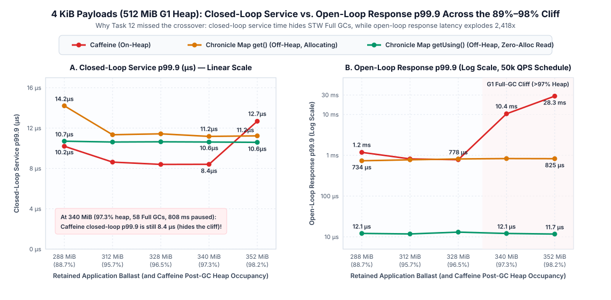
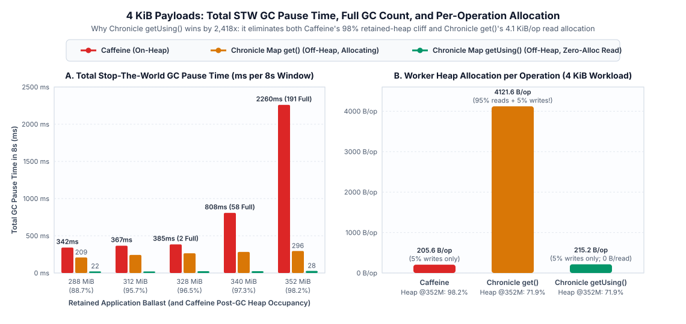
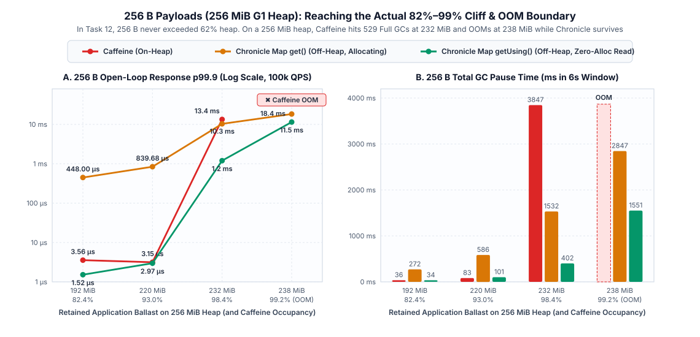

# Post-Campaign Review, Methodological Synthesis, and 90–99% Heap Cliff Diagnostic

**Date:** 8 November 2026

**Branch:** `tailcache-12-crossover`

**Related Artifacts:**
- Primary campaign review: [`docs/TAILCACHE_12_FINAL_OUTCOME_REVIEW.md`](TAILCACHE_12_FINAL_OUTCOME_REVIEW.md)
- Primary campaign acceptance: [`docs/TAILCACHE_12_FINAL_ACCEPTANCE.json`](TAILCACHE_12_FINAL_ACCEPTANCE.json)
- Cliff diagnostic structured evidence: [`docs/TAILCACHE_12_CLIFF_DIAGNOSTIC_EVIDENCE.json`](TAILCACHE_12_CLIFF_DIAGNOSTIC_EVIDENCE.json)
- Cliff diagnostic probe & runner: [`scripts/TailCache12CliffCrossoverProbe.java`](../scripts/TailCache12CliffCrossoverProbe.java), [`scripts/tailcache12_cliff_diagnostic.py`](../scripts/tailcache12_cliff_diagnostic.py)
- Raw cliff GC logs and per-fork JSONs: `evidence-archives/native-final-cliff-crossover-diagnostic-20261108-001/`

---

## 1. Executive Summary

Following the completion of the 402-invocation Task 12 conditional study (`COMPLETE_CONDITIONAL_STUDY_ORIGINAL_PROTOCOL_NO_GO`), we conducted a critical post-mortem of both the **scientific methodology** and the **operational execution** across the Codex campaign, followed by a focused **30-JVM 90–99% heap cliff diagnostic**.

The primary 402-invocation campaign did not establish an unconditional latency crossover between Caffeine (on-heap) and Chronicle Map (off-heap). Our review and follow-up diagnostic established **three root causes** for why the primary campaign missed the crossover, and demonstrated the exact conditions under which the crossover occurs:

1. **The primary campaign stopped just short of G1GC's ~97% evacuation cliff:**
   Because the Task 12 protocol required *"sustainable pressure"* and treated G1 evacuation failure / Full GC as a benchmark rejection rather than the phenomenon under study, calibration capped common retained application ballast at **288 MiB** on a 512 MiB heap. At 4 KiB payloads, 288 MiB put Caffeine at **~89–90.5%** post-GC heap occupancy—just below G1's 10% evacuation reserve cliff (`-XX:G1ReservePercent=10`). Worse, because the same 0–288 MiB ballast schedule was applied to 256 B payloads (where 32,768 cache entries occupy only ~15–20 MiB instead of ~140 MiB), the 256 B campaign never exceeded **~61.5–62.8%** Caffeine heap occupancy.
2. **Closed-loop operation percentiles mask rare stop-the-world GC pauses:**
   Task 12 intentionally measured closed-loop per-operation service time without coordinated-omission correction. In a closed-loop worker executing ~100,000 operations/second, a 20 ms stop-the-world GC pause stalls **one operation** while the remaining 99,999 operations run at normal speed. A single stalled operation out of 100,000 sits at the **p99.999** percentile and barely moves **p99** or **p99.9**. Under **open-loop / coordinated-omission-corrected response latency** (where requests arrive at a steady schedule and queue behind a pause), that same pause stalls thousands of arrivals and dominates `p99.9`.
3. **Standard `ChronicleMap.get(key)` trades retained-heap pressure for 20× higher young-gen allocation pressure:**
   While Chronicle Map in-memory reduced retained post-GC heap occupancy at 4 KiB from ~90% to ~62%, calling ordinary `map.get(key)` deserializes off-heap bytes into a freshly allocated `byte[]` on every read (`4,121.6 B/op` vs Caffeine's `205.6 B/op` at 4 KiB; `281.6 B/op` vs `13.6 B/op` at 256 B). Only when paired with zero-allocation object reuse (`ChronicleMap.getUsing(key, reusableBuffer)`) does off-heap storage eliminate both retained-heap pressure *and* read-path garbage collection.

---

## 2. Review of the 402-Invocation Campaign: Scientific & Operational Gaps

### 2.1 Scientific & Experimental Design Gaps

| Gap | What Happened in Task 12 | Why It Matters |
|---|---|---|
| **Closed-loop timing insensitivity to STW pauses** | Measured synchronous back-to-back operation durations (`opStart` $\to$ `opEnd`) with no arrival schedule. | Even when Caffeine suffered 58 Full GCs (`808 ms` paused in `8 s`, max pause `22.8 ms`), closed-loop `p99.9` stayed at `8.41 µs` while open-loop response `p99.9` hit `10,420 µs`. |
| **Symmetric MiB ballast instead of target heap occupancy** | Used `0, 96, 208, 288 MiB` ballast for both 4 KiB and 256 B payloads on a 512 MiB heap. | At 256 B, "severe pressure" (`288 MiB`) was only `~62%` heap occupancy for both Caffeine and Chronicle—never testing high heap pressure at all. |
| **Capping pressure below the 95%+ cliff** | Stopped at `288 MiB` (`~90%` Caffeine occupancy at 4 KiB) to avoid evacuation failures. | G1GC is specifically engineered to keep young evacuations fast until the ~90% reserve boundary (`G1ReservePercent=10`) is breached. Stopping at 90% stops right before the cliff begins. |
| **Excluding `getUsing()` from the crossover check** | Kept `ChronicleMap.getUsing` out of the primary parity path so both backends returned a `byte[]`. | Allocating a fresh `byte[4096]` on every off-heap read creates ~350–400 MiB/s of young-gen garbage, triggering ratusan of young GCs and masking the off-heap advantage. |
| **256 B 0-MiB baseline anomaly & Caffeine executor** | At 256 B / 0 MiB, Chronicle had half the `p99.9` of Caffeine in every-operation timing, but not in sparse `SampleTime`. | `CaffeineCacheAdapter` uses a bounded cache (`maximumSize`) with the default `ForkJoinPool.commonPool()` executor, running asynchronous write-buffer drains and TinyLFU sketch maintenance alongside the single worker. Recording overhead also altered throughput and GC exposure between the two timing channels. |
| **All four 288 MiB cells disqualified by gates** | Every 288 MiB comparison in the final campaign carried a quality warning (outside CPU >10% or slow thermal read >50 ms). | Left the highest tested pressure point unresolved across the entire primary matrix. |

### 2.2 Process & Operational Lessons: How to Run Future Studies Faster and Cleaner

During the Codex campaign, `Final001` through `Final004` discarded **233 JVM invocations (~4.3 hours)** because any single-fork gate violation terminated the entire 402-invocation study, and `Final005` stopped at fork 143/192 due to a transient 35.1% outside-CPU spike, requiring a post-interruption completion supplement.

1. **Stage-gated screening (Trigger only the crossover region first):**
   - Do not launch a 400-JVM full-factorial grid before verifying that the chosen pressure range and latency metric actually capture a crossover.
   - **Stage 1 (Exploratory Screen):** Run a 15-minute, 20–30 JVM probe right at the suspected high-occupancy boundary (`85%` $\to$ `99%` post-GC heap). Use Stage 1 to locate the exact cliff and verify metric sensitivity.
   - **Stage 2 (Preregistered Confirmatory Run):** Freeze the parameters discovered in Stage 1 and run the replicated matrix *only* on a fresh cohort (never pooling Stage 1 forks into Stage 2 statistics).
2. **Drop-and-Refork vs. Whole-Study Abort:**
   - A single noisy fork should **never** abort an entire multi-hour campaign. The runner should record the rejected fork in the manifest and continue.
   - **When re-forking (replacement) is valid:** Only for **exogenous** host disturbances (outside CPU spikes from unrelated processes, transient thermal sensor read latency, power fluctuations).
   - **When re-forking is invalid (selection bias):** Never re-fork **endogenous** workload events (JIT compilation inside the measured window, GC evacuation failures, churn allocator drops caused by GC stalls). Furthermore, check whether "outside CPU" correlates with high memory pressure (in Task 12, 5 of 6 campaign host warnings occurred at `288 MiB`, suggesting kernel reclaim / `kswapd` activity under memory pressure).
   - **Paired replacement rule:** When an exogenous gate fails, re-run the **entire counterbalanced backend pair** at the end of the pass, capped at $\le 2$ retries per slot and $\le 10\%$ replacements overall, and report both raw and replaced summaries.

---

## 3. Why Managed-Runtime Tail-Latency Papers Are Rare (and Why Low-Level Languages Dominate Strict-SLA Systems)

A key takeaway from this project is *why* rigorous, reproducible tail-latency crossover studies in garbage-collected languages are scarce in the literature—and why production systems with uncompromisable tail SLAs either leave managed runtimes (for C, C++, Rust, Zig) or adopt "C-style zero-allocation Java":

1. **Multi-layer non-stationarity and coupling:**
   In a JVM, `p99.9` latency is never a pure function of the cache data structure. It is an emergent property of coupled feedback loops:
   - **Tiered JIT compilation & deoptimization:** C1 $\to$ C2 recompilation, On-Stack Replacement (OSR), uncommon traps, and inlining invalidations occurring minutes into steady state.
   - **Adaptive GC ergonomics:** G1's adaptive IHOP (Initiating Heap Occupancy Percent), dynamic Eden sizing (which shrinks young generation to minimum size as old generation approaches 90%, turning young GCs into frequent micro-stalls), concurrent marking threads competing for CPU/cache lines, write-barrier card-table dirtying, and TLAB refill slow paths.
   - **Observer perturbation (Heisenberg effect):** Adding per-operation HdrHistogram recording or JFR sampling changes instruction counts, register pressure, C2 inlining decisions, and allocation rates—which is why sparse `SampleTime` and `every-operation` recording disagreed at 256 B.
2. **The "Off-Heap in Java" Catch-22:**
   Naively dropping an off-heap library into an idiomatic Java codebase (`byte[] val = map.get(key)`) simply trades **old-generation retained footprint** for **massive young-generation allocation churn**. To actually achieve C/Rust-like latency determinism on the JVM, engineers must abandon standard Java idioms across the entire hot path: preallocate all buffers, use flyweights or `getUsing(key, reusableTarget)`, pin threads to isolated cores (`isolcpus`), and keep the heap nearly empty (or run `-XX:+UseEpsilonGC`).

---

## 4. The 90–99% Heap Cliff Diagnostic (30 JVMs)

### 4.1 Diagnostic Design

To directly observe the high-occupancy crossover that Task 12 missed, we implemented [`scripts/TailCache12CliffCrossoverProbe.java`](../scripts/TailCache12CliffCrossoverProbe.java) and [`scripts/tailcache12_cliff_diagnostic.py`](../scripts/tailcache12_cliff_diagnostic.py) and executed 30 fresh Java 21 (`21.0.12.1+1`) G1GC JVMs with the exact Task 12 workload generator (`32,768` resident keys, uniform `95%` read / `5%` fresh-value update trace of period `40,001`, `seed = 24301`, `32 MiB/s` independent background churn, lifecycle maintenance warmup enabled).

We compared three cache modes at each pressure step:
1. **`CAFFEINE`**: Standard on-heap Caffeine cache (`maximumSize=65,536`).
2. **`CHRONICLE_GET`**: Off-heap Chronicle Map in-memory using standard allocating `map.get(key)`.
3. **`CHRONICLE_GET_USING`**: Off-heap Chronicle Map in-memory using zero-allocation `map.getUsing(key, reusableBuffer)` on the 95% read path (writes still construct fresh payloads identically to Caffeine).

For every JVM, we recorded:
- **Steady-state post-GC heap occupancy (%)** from raw `-Xlog:gc*,safepoint` logs, plus total GC count, Full GC count, and total GC pause duration.
- **Closed-loop service latency (`p50`, `p99`, `p99.9`, `p99.99`, `max`)**: Raw duration of each operation (`opEnd - opStart`).
- **Open-loop / coordinated-omission-corrected response latency (`p50`, `p99`, `p99.9`, `p99.99`, `max`)**: Recorded via `HdrHistogram.recordValueWithExpectedInterval(gap, expectedIntervalNs)` at a fixed arrival schedule (`50,000 QPS` / `20 µs` interval for 4 KiB; `100,000 QPS` / `10 µs` interval for 256 B), modeling requests queuing behind any stall exceeding the arrival interval.

### 4.2 Sweep 1 Results: `4 KiB` Payloads (`512 MiB` G1 Heap, 8 Warmups + 8 Measured Seconds)

| Ballast | Backend | Steady Post-GC Heap | GC Pauses / Full GCs | Total GC Time (in 8s) | Max Pause | Worker Alloc (B/op) | Closed-Loop `p99` (µs) | Closed-Loop `p99.9` (µs) | Open-Loop `p99` (µs) | Open-Loop `p99.9` (µs) |
|---:|---|---:|---:|---:|---:|---:|---:|---:|---:|---:|
| **288 MiB** | `CAFFEINE` | **88.7%** | 156 / 1 | 342 ms | 7.03 ms | 205.6 | 7.09 | **10.20** | 7.26 | 1,179.65 |
| *(Task 12 max)* | `CHRONICLE_GET` | 59.2% | 229 / 0 | 209 ms | 2.63 ms | 4,121.6 | 7.85 | 14.21 | 8.18 | 733.70 |
| | `CHRONICLE_GET_USING` | 59.4% | **19 / 0** | **22 ms** | 2.32 ms | **215.2** | 7.63 | 10.70 | 7.67 | **12.14** |
| **312 MiB** | `CAFFEINE` | **95.7%** | 248 / 1 | 367 ms | 3.35 ms | 205.6 | 7.06 | **8.63** | 7.20 | 814.59 |
| | `CHRONICLE_GET` | 63.9% | 276 / 0 | 243 ms | 1.91 ms | 4,121.6 | 7.78 | 11.34 | 7.96 | 773.63 |
| | `CHRONICLE_GET_USING` | 64.1% | **21 / 0** | **21 ms** | 2.18 ms | **215.2** | 7.55 | 10.62 | 7.60 | **11.78** |
| **328 MiB** | `CAFFEINE` | **96.5%** | 274 / 2 | 385 ms | 3.86 ms | 205.6 | 7.00 | **8.40** | 7.13 | 778.24 |
| | `CHRONICLE_GET` | 67.0% | 305 / 0 | 265 ms | 2.06 ms | 4,121.6 | 7.78 | 11.43 | 8.00 | 812.03 |
| | `CHRONICLE_GET_USING` | 67.2% | **24 / 0** | **24 ms** | 1.80 ms | **215.2** | 7.57 | 10.64 | 7.62 | **13.06** |
| **340 MiB** | `CAFFEINE` | **97.3%** | 277 / **58** | **808 ms** | **22.77 ms** | 205.6 | 7.02 | **8.41** | 7.28 | **10,420.22** |
| *(Cliff starts)* | `CHRONICLE_GET` | 69.3% | 331 / 0 | 283 ms | 2.07 ms | 4,121.6 | 7.84 | 11.18 | 8.07 | 830.98 |
| | `CHRONICLE_GET_USING` | 69.5% | **26 / 0** | **24 ms** | 1.82 ms | **215.2** | 7.54 | 10.62 | 7.59 | **12.09** |
| **352 MiB** | `CAFFEINE` | **98.2%** | 252 / **191** | **2,260 ms** | **76.48 ms** | 205.6 | 7.68 | 12.68 | **8,929.28** | **28,295.17** |
| *(Severe cliff)* | `CHRONICLE_GET` | 71.9% | 360 / 0 | 296 ms | 2.06 ms | 4,121.6 | 7.92 | 11.23 | 8.27 | 825.34 |
| | `CHRONICLE_GET_USING` | 71.9% | **29 / 0** | **28 ms** | 2.09 ms | **215.2** | **7.56** | **10.59** | **7.60** | **11.70** |

### 4.3 Sweep 2 Results: `256 B` Payloads (`256 MiB` G1 Heap, 6 Warmups + 6 Measured Seconds)

| Ballast | Backend | Steady Post-GC Heap | GC Pauses / Full GCs | Total GC Time (in 6s) | Max Pause | Worker Alloc (B/op) | Closed-Loop `p99` (µs) | Closed-Loop `p99.9` (µs) | Open-Loop `p99` (µs) | Open-Loop `p99.9` (µs) |
|---:|---|---:|---:|---:|---:|---:|---:|---:|---:|---:|
| **192 MiB** | `CAFFEINE` | 82.4% | 29 / 0 | 36 ms | 3.73 ms | 13.6 | 1.42 | 2.82 | 1.50 | 3.56 |
| | `CHRONICLE_GET` | 80.9% | 328 / 0 | 272 ms | 2.05 ms | 281.6 | 0.91 | 1.61 | 0.97 | 448.00 |
| | `CHRONICLE_GET_USING` | 80.9% | 35 / 0 | 34 ms | 2.51 ms | 23.2 | **0.84** | **1.22** | **0.88** | **1.52** |
| **220 MiB** | `CAFFEINE` | 93.0% | 88 / 1 | 83 ms | 2.15 ms | 13.6 | 1.28 | 2.47 | 1.34 | 3.15 |
| | `CHRONICLE_GET` | 91.0% | 792 / 1 | 586 ms | 4.43 ms | 281.6 | 0.99 | 3.18 | 1.19 | 839.68 |
| | `CHRONICLE_GET_USING` | 91.0% | 120 / 1 | 101 ms | 2.17 ms | 23.2 | **0.83** | **1.18** | **0.87** | **2.97** |
| **232 MiB** | `CAFFEINE` | **98.4%** | 600 / **529** | **3,847 ms** | 22.07 ms | 13.6 | 1.47 | 2.54 | 10,526.72 | 13,369.34 |
| *(98% cliff)* | `CHRONICLE_GET` | 97.3% | 1,590 / 88 | 1,532 ms | 15.39 ms | 281.6 | 1.09 | 3.77 | 383.74 | 10,321.92 |
| | `CHRONICLE_GET_USING` | 98.0% | 288 / 40 | **402 ms** | 14.39 ms | 23.2 | **0.88** | **1.37** | **0.95** | **1,201.15** |
| **238 MiB** | `CAFFEINE` | **99.2%** | — / 7 | **OOM** | — | — | **OOM** | **OOM** | **OOM** | **OOM** |
| *(Survival)* | `CHRONICLE_GET` | 98.8% | 1,371 / 316 | 2,847 ms | 33.54 ms | 281.6 | 1.40 | 5.78 | 9,314.30 | 18,366.46 |
| | `CHRONICLE_GET_USING` | 99.2% | 365 / 235 | **1,551 ms** | 21.51 ms | 23.2 | **0.93** | **1.62** | **28.94** | **11,468.80** |
| **244 MiB** | All 3 backends | >99.2% | — / 7–8 | **OOM** | — | — | **OOM** | **OOM** | **OOM** | **OOM** |

### 4.4 Diagnostic Figures

Generated by [`scripts/tailcache12_plot_cliff_diagnostic.py`](../scripts/tailcache12_plot_cliff_diagnostic.py) (both `.svg` and high-DPI `.png` in [`docs/figures/`](figures/)):

---

## 5. Key Findings & Practical Engineering Answers

1. **Where the Crossover Actually Occurs (RQ1 & RQ2):**
   - Under **closed-loop service latency**, a crossover is nearly invisible until the JVM is spending >25% of wall-clock time in Full GC (`352 MiB` / `98.2%` Caffeine heap at 4 KiB, where Caffeine `p99.9` reaches `12.68 µs` vs Chronicle's `11.23 µs` (`get`) and `10.59 µs` (`getUsing`)). Even at `97.3%` heap (`340 MiB`, 58 Full GCs), closed-loop `p99.9` still reports `8.41 µs` for Caffeine.
   - Under **open-loop response latency** (or total pause exposure), the cliff is sharp and dramatic: as Caffeine crosses **97.3% post-GC occupancy (`340 MiB`)**, To-Space Exhaustion triggers 58 Full GCs and Caffeine's open-loop `p99.9` jumps from `778 µs` to **`10,420 µs` (10.4 ms)**, and at **98.2% (`352 MiB`)** it hits 191 Full GCs and **`28,295 µs` (28.3 ms)** (`p99 = 8.93 ms`). Across that entire cliff, Chronicle's heap sits at `69–72%` with **zero Full GCs**, holding open-loop `p99.9` at **`825 µs`** (`CHRONICLE_GET`) and **`11.70 µs`** (`CHRONICLE_GET_USING`).
   - At **256 B** (on a 256 MiB heap), pushing ballast to `232 MiB` (`98.4%` Caffeine occupancy) triggers 529 Full GCs (`3.85 s` of pauses in `6 s`, open-loop `p99.9 = 13.37 ms`), compared to `402 ms` of pauses and `1.20 ms` open-loop `p99.9` for `CHRONICLE_GET_USING`. At `238 MiB`, **Caffeine crashes with `OutOfMemoryError`** while both Chronicle modes survive.
2. **Why `getUsing()` (Object Reuse) Is Mandatory for Off-Heap Caching:**
   - Moving entries off-heap with ordinary `ChronicleMap.get(key)` allocates a new `byte[]` on every read (`4,121.6 B/op` at 4 KiB; `281.6 B/op` at 256 B). At 256 B / 220 MiB (`91%` heap), `CHRONICLE_GET` actually suffers **9× more GC pauses** (`792` vs `88`) and **266× worse open-loop `p99.9`** (`839.7 µs` vs `3.15 µs`) than Caffeine because its read allocations flood a narrow young generation!
   - Switching to `ChronicleMap.getUsing(key, reusableBuffer)` eliminates read-path allocation entirely (leaving only `215.2 B/op` at 4 KiB and `23.2 B/op` at 256 B from the 5% write path), cutting GC pause time by **10×** and delivering **`11.7–13.1 µs` open-loop `p99.9`** at 4 KiB even when the equivalent on-heap cache is stalling for `28.3 ms`.
3. **Practical Engineering Rule of Thumb:**
   - **Below ~85–90% post-GC heap occupancy:** Stay on-heap (`Caffeine`). It is simpler, avoids serialization/deserialization, and matches or beats off-heap latency.
   - **Approaching >90% heap occupancy (or when cache payload footprint dominates the heap):** Off-heap (`Chronicle Map`) prevents G1's To-Space Exhaustion / Full GC cliff and extends the OOM boundary—**provided** the hot read path uses zero-allocation object reuse (`getUsing` / flyweights). Using off-heap storage with allocating `get()` calls under high heap occupancy can make young-GC pause frequency *worse* than an on-heap cache.
   - **When tail latency is strictly uncompromisable (`<50 µs` hard SLA with zero multi-millisecond stalls):** Either run zero-allocation off-heap Java with no background heap churn, or use a non-GC systems language (`Rust`, `C++`, `C`).
