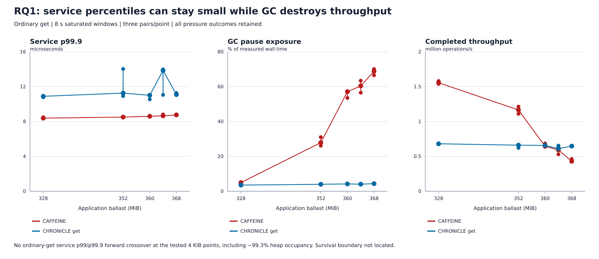
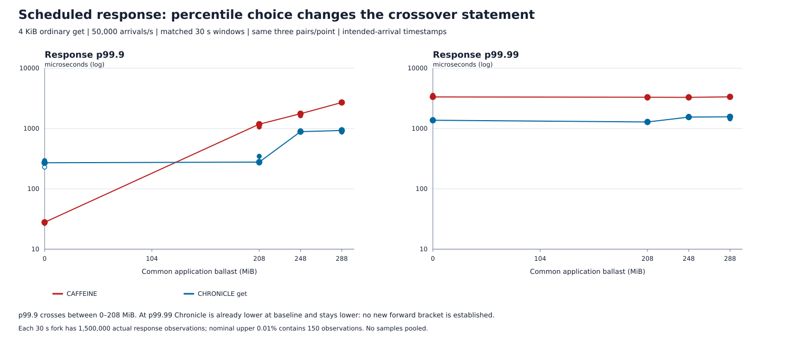
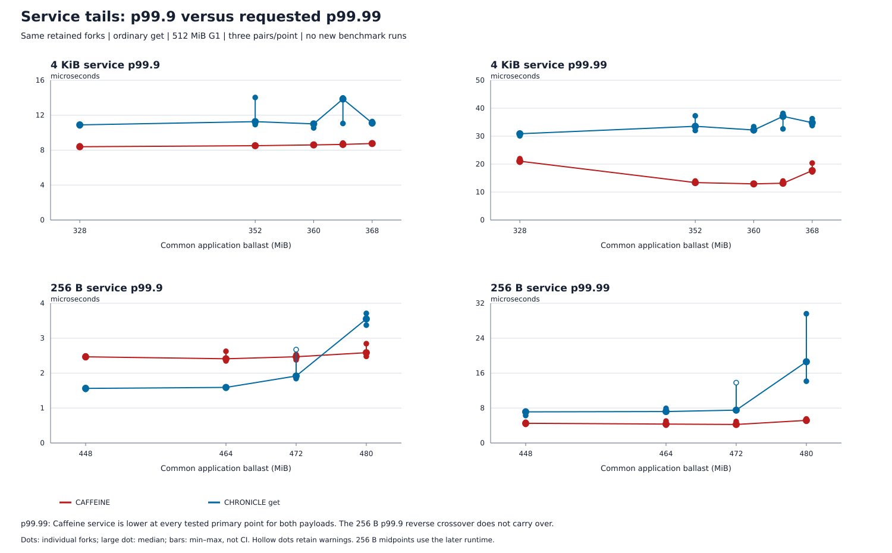

# Focused crossover results and researcher review — 8 November 2026

> Historical evidence note (26 November 2026): paths under `evidence-archives/`
> identify local collection artifacts excluded from Git, rather than downloadable
> files in this checkout. See the [evidence index](EXPERIMENT_EVIDENCE.md) and
> [retained derived observations](preprint/paper-data.json) for public evidence.

[Open the interactive conclusions table and crossover graphs](TAILCACHE_RESULTS_EXPLORER.html). It covers all 132 forks, all four percentiles, and each retained timing channel, with paired evidence and CSV export.

**The first useful RQ answers are complete. Collection is stopped.** At 4 KiB, ordinary Chronicle `get` has a reproducible advantage in **actual scheduled response p99.9** after pressure increases, but **no forward crossover in saturated service p99/p99.9 was observed** at the tested high-pressure points. At 256 B, service p99.9 crosses in the opposite direction: Chronicle starts lower and becomes higher near heap saturation. Buffer reuse reverses that disadvantage in a separately labelled sensitivity.

**Requested p99.99 extension:** percentile choice changes those statements. At p99.99, Chronicle already has lower scheduled response at the zero-ballast 4 KiB baseline, while Caffeine has lower saturated service at every tested ordinary-get point for both payloads. The 256 B buffer-reuse service advantage at p99.9 also does not extend to p99.99. The [comparison below](#requested-p9999-extension) uses the same retained distributions; no new benchmark was run and the original endpoints remain reported.

These are exploratory results answering where a useful effect exists and which endpoint sees it. They do not establish a universal occupancy threshold. All 132 workload JVMs completed, verified resident values and remain in the dataset, including warning-bearing forks. There were zero replacement forks, OOMs or censored arrivals. Historical Task 12 and earlier diagnostic evidence retain their original classifications.

**Requested p99.999 extension:** the rarer service tail changes ordering: Chronicle is lower at all five saturated 4 KiB points. At 256 B, saturated service changes from Caffeine lower at 448 MiB to Chronicle lower at 480 MiB within the earlier runtime. Scheduled 4 KiB response remains lower for Chronicle even at baseline. [Read the p99.999 review and finite-support limits](#requested-p99999-extension).

**Full-tail follow-up:** the explorer now includes every retained bin and strict probabilities of exceeding 100 µs, 1 ms and 10 ms. The [frozen claims](TAILCACHE_FROZEN_CLAIMS.md) keep the conclusions specific to payload, workload, percentile and ownership contract. No confirmation batch has been launched.

## RQ1 at p99/p99.9: response crossover exists; ordinary service crossover did not reproduce

The scheduled experiment offers 50,000 requests/s to a single worker. Response is completion minus **intended arrival**, including backlog after a pause. Intended times never move after a stall, no overdue arrivals are skipped, and every offered request is accounted for. This differs from the earlier diagnostic's synthetic expected-interval histogram correction. Service is completion minus actual operation start; the saturated service experiment uses separate JVMs.

For matched 30-second offered windows, ordinary `get`, 4 KiB values and a fixed 512 MiB G1 heap:

| Common application ballast | Caffeine response p99.9 | Chronicle response p99.9 | Three paired Chronicle/Caffeine ratios |
| --- | --- | --- | --- |
| 0 MiB | 26.8–28.5 µs | 229–294 µs | 10.973, 9.516, 8.211 |
| 208 MiB | 1.060–1.205 ms | 0.268–0.347 ms | 0.327, 0.230, 0.227 |
| 248 MiB | 1.627–1.779 ms | 0.882–0.920 ms | 0.546, 0.501, 0.517 |
| 288 MiB | 2.671–2.757 ms | 0.873–0.959 ms | 0.323, 0.348, 0.348 |

**The observed forward response crossover is bracketed between 0 and 208 MiB ballast.** This corresponds to roughly 31–33% versus 72% measured Caffeine post-GC heap occupancy. It already occurs before the severe Full-GC region; the data do not support a universal “97% cliff.” No intermediate threshold is interpolated. At 352 MiB in the separate short-window batch, the advantage grows: Caffeine 19.79–20.40 ms versus Chronicle 1.075–1.222 ms, all three pairs.

For **saturated ordinary service**, all three pairs at each tested 4 KiB point—328, 352, 360, 364 and 368 MiB—favor Caffeine at both p99 and p99.9. At 368 MiB, Caffeine service p99.9 is 8.73–8.80 µs versus Chronicle 11.02–11.28 µs, even though Caffeine reaches about 99.3% post-GC occupancy and spends 66.5–70.1% of measured wall time in GC. Throughput then favors Chronicle: approximately 0.647–0.654 million operations/s versus 0.426–0.463 million/s.

This is not evidence that GC has little cost. At that point Caffeine has 313–333 measured Full GCs, but pause events are only about 0.018% of completed operations, below the 0.1% tail defining p99.9. Time lost to long pauses can dominate wall time while leaving an operation-weighted service percentile small. Queue-sensitive response and throughput expose the cost. This explains the endpoint disagreement without redefining the original service question after observing the results. No OOM occurred; a capacity-survival boundary was not located.

## RQ2: smaller values move the pressure region and can reverse the service ordering

Both payloads use the **same 512 MiB heap**, resident count, trace and offered background allocation. the earlier diagnostic's 256 B/256 MiB and 4 KiB/512 MiB discovery configurations are useful for choosing regions, but are not a controlled payload-only comparison.

| 256 B ordinary saturated service | Paired Chronicle/Caffeine p99.9 ratios | Observation |
| --- | --- | --- |
| 448 MiB ballast | 0.635, 0.634, 0.628 | Chronicle lower in all pairs |
| 464 MiB | 0.677, 0.609, 0.652 | Chronicle lower in all pairs |
| 472 MiB | 0.775, 0.758, 1.083 | Mixed; reversing pair has an outside-CPU warning |
| 480 MiB | 1.374, 1.186, 1.497 | Caffeine lower in all pairs |

The **same-runtime original batch establishes a reverse service crossover somewhere between 448 and 480 MiB**. Later midpoint batches suggest the transition is toward the upper end, but use the newer runner runtime described below; they do not justify a precise pooled threshold. At 480 MiB, Caffeine service p99.9 is 2.48–2.84 µs versus Chronicle 3.37–3.71 µs. In contrast, scheduled response at this point still favors Chronicle in all three pairs: about 1.20–9.85 ms versus Caffeine 18.96–18.99 ms. The large Chronicle spread remains visible.

Reaching comparable near-full Caffeine occupancy takes roughly 128 MiB more application ballast for 256 B than 4 KiB values (480 versus 352 MiB). The payload-footprint difference alone is 120 MiB for 32,768 entries. This is consistent with the pressure region moving with heap-resident payload size; it is not an exact or general crossover-threshold formula. At a common ballast and offered load, the backends' total occupancy is allowed to differ: equalizing it would remove the memory-saving mechanism under study.

## Read allocation explains a useful sensitivity, with a different ownership contract

The primary comparison keeps ordinary Chronicle `get`, which materializes a fresh value array. A separate `getUsing` arm borrows a caller buffer, checks the returned buffer's identity and uses the same fresh immutable write-generation rule. Tests verify that modifying the caller buffer does not change stored values.

| Sensitivity | Ordinary Chronicle | Chronicle `getUsing` | Interpretation |
| --- | --- | --- | --- |
| 256 B worker allocation | 281.6 B/op | 23.2 B/op | Read materialization largely removed; writes still allocate |
| 4 KiB worker allocation | 4121.6 B/op | 215.2 B/op | Caffeine is approximately 205.6 B/op for comparison |
| 256 B / 480 MiB service p99.9 | 3.37–3.71 µs | 1.20–1.26 µs | Reuse beats its own paired Caffeine controls in all three pairs, ratios 0.475–0.510 |
| 4 KiB / 352 MiB response p99.9 | 1.075–1.222 ms | 27.9–51.3 µs | Reuse beats its own paired Caffeine controls, 20.5–21.1 ms, in all three pairs |

Ordinary and reuse values above come from separate labelled batches; they are not histograms pooled across contracts. The reduction is strong evidence that read allocation matters under pressure. It does not isolate every internal cause or establish universal zero allocation. Reuse changes ownership semantics and cannot be substituted retroactively for ordinary-get RQ1. The smallest reuse response tails approach the measured pacing floor; no floor subtraction or bare-library latency claim is made. The proposed Caffeine-executor explanation for its 256 B baseline remains untested.

## Requested p99.99 extension

This user-requested endpoint was added after collection. It is derived from all 132 retained workload JVMs, not from reruns or interpolated percentile summaries. Every full distribution was decoded again using the pinned HDR 2.2.2 implementation and checked against exported bins. The extension leaves the original study and 90 MB delivery archive byte-for-byte unchanged.

**RQ1 service: the larger percentile still does not produce a forward crossover.** For ordinary saturated 4 KiB access, Caffeine has lower p99.99 at every tested point, in all three pairs:

| Application ballast | Caffeine service p99.99 | Chronicle service p99.99 | Paired Chronicle/Caffeine ratios |
| --- | --- | --- | --- |
| 328 MiB | 20.69–21.94 µs | 30.11–31.02 µs | 1.431, 1.500, 1.407 |
| 352 MiB | 13.21–13.95 µs | 32.03–37.28 µs | 2.672, 2.538, 2.392 |
| 360 MiB | 12.84–13.03 µs | 31.97–33.41 µs | 2.473, 2.509, 2.564 |
| 364 MiB | 13.05–13.96 µs | 32.61–38.14 µs | 2.818, 2.498, 2.733 |
| 368 MiB | 17.20–20.38 µs | 33.79–36.26 µs | 2.051, 1.965, 1.708 |

At 368 MiB, Caffeine's three forks contain approximately 333 / 3,709,660, 313 / 3,407,447 and 315 / 3,439,035 service observations of at least 1 ms: **0.00898–0.00919% of completed operations**, still below 0.01%. These counts use HDR upper-equivalent bin bounds. Their inter-completion gap distributions have the same millisecond counts and p99.99 of 18.02–20.83 µs. Thus this example does not require pauses to be hidden between service timestamps: sufficiently rare millisecond observations can dominate elapsed time while remaining beyond p99.99 in both channels. GC pause counts cannot be substituted for a count of millisecond service observations; they include shorter pauses and are not a one-to-one operation attribution. The lost throughput and queue-response cost remain real.

**RQ1 response: Chronicle's advantage is already present at baseline at p99.99.** For the same 30 s / 50,000 arrivals/s comparisons:

| Application ballast | Caffeine response p99.99 | Chronicle response p99.99 | Paired Chronicle/Caffeine ratios |
| --- | --- | --- | --- |
| 0 MiB | 3.316–3.551 ms | 1.359–1.398 ms | 0.418, 0.386, 0.410 |
| 208 MiB | 3.193–3.328 ms | 1.257–1.314 ms | 0.411, 0.386, 0.381 |
| 248 MiB | 3.219–3.375 ms | 1.528–1.592 ms | 0.481, 0.453, 0.484 |
| 288 MiB | 3.297–3.422 ms | 1.447–1.570 ms | 0.432, 0.459, 0.475 |

Chronicle is lower in all three pairs at each point, including warning-free pairs. The initial 8 s baseline also favors Chronicle in all three pairs at p99.99. Therefore the p99.9 forward bracket of 0–208 MiB **does not carry over**: at p99.99 there is an observed advantage throughout these tested response points, rather than a newly established pressure-induced crossing. At 352 MiB in the short-window primary batch, response p99.99 is 21.20–22.69 ms for Caffeine versus 1.523–2.759 ms for Chronicle.

**RQ2 service: percentile choice changes the 256 B ordering.** Ordinary saturated access now favors Caffeine at every tested point:

| Application ballast | Caffeine service p99.99 | Chronicle service p99.99 | Paired Chronicle/Caffeine ratios |
| --- | --- | --- | --- |
| 448 MiB | 4.263–4.751 µs | 6.287–7.287 µs | 1.534, 1.581, 1.475 |
| 464 MiB | 4.089–5.027 µs | 7.143–7.935 µs | 1.663, 1.421, 1.941 |
| 472 MiB | 4.219–4.931 µs | 7.395–13.815 µs | 1.784, 1.500, 3.256 |
| 480 MiB | 4.987–5.515 µs | 14.143–29.599 µs | 3.374, 2.836, 5.711 |

The warned 472 MiB fork remains visible; both clean pairs also favor Caffeine. The p99.9 reverse crossover is consequently specific to that percentile; it is not a crossing of the whole latency distribution. Smaller payloads continue to require more ballast to reach high occupancy, but a service p99.99 crossover was not established for either payload in these tested points.

**Buffer reuse is also percentile-sensitive.** At 256 B / 480 MiB, `getUsing` service p99.99 is 6.407–7.675 µs against its own paired Caffeine controls at 4.891–5.691 µs: ratios 1.158, 1.349 and 1.442, all clean. Reuse still removes most read allocation and improves ordinary Chronicle's service tail, but its p99.9 advantage over Caffeine reverses at p99.99. At 4 KiB / 352 MiB, reuse response p99.99 remains lower than its own Caffeine controls: 1.365–1.461 ms versus 22.10–23.41 ms. It is no longer near the microsecond pacing floor at this more extreme percentile, despite the much smaller p99.9 values.

Review limits: each 8 s arrival fork has 400,000 observations, leaving a nominal 40 observations in the upper 0.01%; each 30 s fork has 1.5 million, leaving 150. Queued responses during one pause are correlated, so these are not 40 or 150 independent stall episodes. The 12 one-second arrival-floor controls have only 50,000 responses each (five nominal tail observations); their p99.99 ranges from 120.5–151.8 µs. This is a short-duration harness diagnostic, not a transferable 30 s baseline or a value to subtract. Closed-loop counts and HDR-bin ties are reported per fork; a large operation count does not remove run-to-run uncertainty. There is no outlier trimming, pooling, invented confidence interval or newly relaxed acceptance gate.

The p99.99 dataset (`evidence-archives/focused-rq-p9999-20261108-001/study.json`), all per-point comparisons (`evidence-archives/focused-rq-p9999-20261108-001/comparisons.md`), 396 channel rows (`evidence-archives/focused-rq-p9999-20261108-001/forks.csv`) and audit (`evidence-archives/focused-rq-p9999-20261108-001/audit.json`) preserve individual values, warnings, sample support and source groups. Validation decoded 504 workload/control HDR distributions, checked 1,344 nonempty workload percentile endpoints and reverified all 3,960 original inventory files. No measured workload code or retained observation was changed. Future focused collector summaries include p99.99 derived from the full bins; legacy raw summary files remain readable. All 66 paired p99.99 ratios agree with that collector. Five focused and 207 existing Task 12 Python tests pass, including a boundary case proving p99.99 is a count-weighted rank rather than the maximum.

The separate `focused-rq-p9999-delivery-20261108-001.tar.gz` preserves this derivative, updated analysis/collector/decoder source, review and plots, with read-back verification. Its manifest pins the original delivery archive by hash; the original archive is required alongside this supplement for the complete raw evidence. Neither archive is an off-host backup.

## Requested p99.999 extension

This is a post hoc endpoint from the same retained distributions, with **zero new workload runs**. It extends the reported distribution; it does not replace p99, p99.9 or p99.99 or retroactively change the original hypothesis.

**4 KiB saturated ordinary service now favors Chronicle at every tested point, in all three pairs.** This is a different conclusion from p99.99, where all five points favor Caffeine:

| Application ballast | Caffeine service p99.999 | Chronicle service p99.999 | Paired Chronicle/Caffeine ratios |
| --- | --- | --- | --- |
| 328 MiB | 1.614–1.651 ms | 1.463–1.492 ms | 0.902, 0.904, 0.919 |
| 352 MiB | 16.695–18.022 ms | 1.411–1.434 ms | 0.081, 0.084, 0.080 |
| 360 MiB | 17.973–18.989 ms | 1.422–1.451 ms | 0.077, 0.081, 0.075 |
| 364 MiB | 18.268–19.218 ms | 1.395–1.435 ms | 0.075, 0.076, 0.074 |
| 368 MiB | 18.383–19.251 ms | 1.384–1.419 ms | 0.077, 0.074, 0.073 |

At 368 MiB, the millisecond observations previously documented beyond p99.99 are now inside the reported tail. This is consistent with the frequency explanation above. It does not establish that every measured stall was caused by GC. Because Chronicle already wins at the lowest tested saturated pressure of 328 MiB at this percentile, these measurements establish an advantage throughout that range, **not a newly bracketed forward service crossover**. Builds remain separated in the explorer.

**4 KiB scheduled response p99.999 also favors Chronicle at all measured points.** Within the matched later-runtime 30 s cohort, the zero-ballast baseline is 3.779–4.135 ms for Caffeine versus 1.701–1.759 ms for Chronicle; at 208 MiB it is 3.541–3.727 ms versus 1.491–1.762 ms. There is already an advantage at baseline, so the p99.9 forward response bracket remains specific to that endpoint.

**256 B saturated ordinary service has a forward p99.999 ordering change between 448 and 480 MiB in the earlier runtime:** Caffeine is lower in all three pairs at 448 MiB (23.951–24.671 µs versus 1.029–1.065 ms); Chronicle is lower in all three pairs at 480 MiB (1.064–1.123 ms versus 1.238–1.356 ms for Caffeine). The later-runtime 464/472 MiB observations favor Caffeine; they cannot narrow the earlier-runtime bracket. The 472 MiB warning remains attached. At 256 B scheduled response, 448 MiB is mixed and 480 MiB favors Chronicle, with substantial fork variation. In the separate 256 B / 480 MiB getUsing comparison, Chronicle service p99.999 is lower in all three clean pairs, but Caffeine's range spans 29.487 µs–17.351 ms; the very different ratio magnitudes must remain visible.

**Finite support is particularly important here.** An 8 s arrival fork has only **4 nominal observations** in its upper 0.001%; a 30 s arrival fork has **15**. Queued responses are correlated. The explorer shows nominal support and observations strictly above the selected HDR bin for every percentile and fork. These are not independent pause counts or confidence intervals. One-second arrival-floor controls have only 0.5 nominal upper-tail observations at p99.999; they are diagnostic and are not subtracted from measured latency. No trimming, pooling or new gate relaxation was used.

The p99.999 dataset (`evidence-archives/focused-rq-p99999-20261108-001/study.json`), primary comparisons (`evidence-archives/focused-rq-p99999-20261108-001/comparisons.md`), 396 channel rows (`evidence-archives/focused-rq-p99999-20261108-001/forks.csv`) and audit (`evidence-archives/focused-rq-p99999-20261108-001/audit.json`) retain the prior endpoints and append p99.999. Validation decoded **504 workload/control HDR histograms**, independently checked **1,680** nonempty workload endpoints and reverified **3,960** original inventory files. Original studies and both previous delivery bundles are hash-verified unchanged. p99.999 is computed by the pinned HDR rank rule, not substituted with a maximum. The updated collector handles legacy summaries without inventing absent percentiles.

The first RQ answer is consequently **distribution- and load-dependent**: Chronicle's 4 KiB service disadvantage at p99.99 coexists with a service advantage at p99.999 and lower scheduled response at both endpoints. The off-heap benefit is visible in rarer stalls, while ordinary-access overhead remains visible lower in the distribution. This exploratory extension supports a more precise hypothesis for future confirmation; it does not turn three short forks into a precise threshold or a universal performance claim.

## Offline full-tail and stall-probability review

The survival curves show empirical P(T > t) separately for each fork, at every recorded HDR bin boundary. They use all **1,704,023 bins** across **336 nonempty workload channels**, with no pooling, smoothing or outlier trimming. The three fixed thresholds were requested before this offline analysis. Their rates use the full operation count as denominator, not elapsed time or a count of GC events.

The following ranges span three forks and any threshold-straddling HDR bin; they are not confidence intervals. C / Ch means Caffeine / Chronicle.

| 4 KiB ordinary workload | Ballast | >100 µs, C / Ch | >1 ms, C / Ch | >10 ms, C / Ch |
| --- | --- | --- | --- | --- |
| Scheduled response (30 s) | 0 MiB | 0.0755333%–0.0848667% / 0.1114%–0.1164% | 0.0519333%–0.0592% / 0.0354667%–0.0416667% | 0% / 0% |
| Scheduled response (30 s) | 208 MiB | 0.1574%–0.163467% / 0.115933%–0.1244% | 0.1034%–0.109467% / 0.0316%–0.0363333% | 0% / 0% |
| Scheduled response (30 s) | 248 MiB | 0.2078%–0.223533% / 0.238%–0.247067% | 0.137867%–0.1476% / 0.0802667%–0.0859333% | 0% / 0% |
| Scheduled response (30 s) | 288 MiB | 0.5794%–0.582933% / 0.265467%–0.279733% | 0.378867%–0.382067% / 0.0746667%–0.092% | 0% / 0% |
| Saturated service (8 s) | 328 MiB | 0.00216868%–0.0023399% / 0.0051596%–0.00554248% | 0.0013494%–0.00148681% / 0.00374802%–0.00403757% | 7.90659e-06%–8.12467e-06% / 0% |
| Saturated service (8 s) | 352 MiB | 0.00215892%–0.00290285% / 0.00674527%–0.00682814% | 0.00215892%–0.00290285% / 0.00450165%–0.00460926% | 0.00107946%–0.00145143% / 0% |
| Saturated service (8 s) | 360 MiB | 0.00482903%–0.0052437% / 0.00719083%–0.00724613% | 0.00482903%–0.00522435% / 0.00478379%–0.00488781% | 0.00482903%–0.00522435% / 0% |
| Saturated service (8 s) | 364 MiB | 0.00529413%–0.00653166% / 0.00746446%–0.00755098% | 0.00529413%–0.00653166% / 0.00465813%–0.00504766% | 0.00529413%–0.00653166% / 0% |
| Saturated service (8 s) | 368 MiB | 0.00900352%–0.0092177% / 0.00773586%–0.00782269% | 0.00897656%–0.00918576% / 0.00465521%–0.00490002% | 0.00897656%–0.00918576% / 0% |

**Frequency and severity trade off.** At 328 and 352 MiB saturated service, Caffeine has lower >100 µs and >1 ms operation probabilities in all three pairs, while Chronicle has lower >10 ms probability. At 360 and 364 MiB the >100 µs comparison still favors Caffeine, but >1 ms and >10 ms favor Chronicle. At 368 MiB Chronicle has lower probabilities at all three thresholds. These are distribution-specific comparisons, not a universal off-heap advantage.

At 368 MiB, Caffeine has exactly 333, 313 and 315 recorded operations exceeding 10 ms, out of 3,709,660 / 3,407,447 / 3,439,035 operations. Chronicle has zero observed >10 ms operations in its 5,228,379 / 5,183,650 / 5,177,000 operations. The absence of an event in these short forks does not establish zero underlying risk or quantify independent pause episodes.

The later-runtime 30 s response baseline has lower >100 µs probability for Caffeine but lower >1 ms probability for Chronicle. Both backends have zero observed >10 ms responses at all four 30 s pressure points. At 248 MiB the same >100 µs versus >1 ms ordering split appears. Thus a lower extreme percentile can coexist with a higher frequency of moderately slow operations.

**Recorder precision is kept explicit.** Where a requested threshold falls inside an occupied HDR bin, the definite count includes only bins entirely above it, while the possible count also includes the straddling bin. For example, one 0 MiB Chronicle response fork has 532–533 >1 ms observations, not an invented exact count. All probabilities at HDR upper-bin boundaries are exact for the retained binned distribution. No sub-bin event timings can be recovered.

Independent Java decoding and Python analysis agree on all **1,188 threshold checks** and on the lower/upper bounds of all recorded bins. The 792 raw HDR/bin files are verified against retained hashes; the three previous delivery bundles and the p99.999 study remain unchanged. The tail dataset (`evidence-archives/focused-rq-tails-20261108-001/tails.json`), all 1,188 per-channel threshold rows (`evidence-archives/focused-rq-tails-20261108-001/stall-rates.csv`) and audit (`evidence-archives/focused-rq-tails-20261108-001/audit.json`) retain full curves, count bounds and provenance. Empty closed-loop response channels remain empty.

**Research decision:** this offline extension explains the apparent percentile contradictions without more collection. The [frozen claims](TAILCACHE_FROZEN_CLAIMS.md) supersede an unqualified “ordinary service crossover is unsupported”: 4 KiB has no observed service pressure bracket for the tested endpoints, but p99.999 favors Chronicle throughout the measured high-pressure range, and 256 B has endpoint-specific ordering changes. A new 18-JVM 0/104/208 MiB response batch is useful only to test repetition and narrow the p99.9 bracket; it is not required to establish that the observed effect exists. It remains unlaunched.

## Methods, warnings and independent review

The [pre-implementation plan and staged decisions](TAILCACHE_FOCUSED_REDO.md) record what each bounded batch was intended to resolve. Twelve batches contain 132 workload JVMs plus 36 tiny control JVMs. No batch has more than 24 workload JVMs. Active collection totals about **64 minutes**; workload collection ran from 12:48 to 14:05 IST on 8 November, with implementation/review gaps. All slots were preserved; no whole-study restart was used.

Shared inputs are 32,768 resident entries, a uniform 40,001-operation trace with approximately 95/5 reads/updates, seed 24301, Java 21, G1, fixed 512 MiB heap and a continuously running 32 MiB/s offered application-churn thread. The actual Caffeine capacity is 40,960, not an assumed 65,536. Closed-loop duration naturally produces different completed operation counts and cumulative write versions across backends; it shares the deterministic trace and fresh-value generation rule, not byte-identical final states after different numbers of updates. Arrival measurement windows have exact equal request counts. Each final state is verified against its own expected versions and resident count outside timing. Chronicle retains no heap payload bank.

Three small lifecycle trials precede each JVM's workload. Short batches use 8 s warmup / 2 s conditioning / 8 s measurement; long response batches use 12 / 2 / 30 s. Compiler deltas, all phase clocks, churn realization, allocation, host/power/thermal observations, complete GC logs, raw HDR histograms, exact classpath and source are retained. Analytics is explicitly disabled and checked. Chronicle storage is **in memory**; this follow-up makes no persisted cold/open/page-fault claim. Backend configuration, including tiering policy, is logged. Full GC and occupancy are computed only over actual measurement clocks, including any scheduled drain, never over setup or verification.

The harness's injected 20 ms stall produces approximately 19.3 ms scheduled-response p99.9 with all 50,000 control requests conserved. The timer-only response floor is about 20.8 µs in the initial control. Every-operation service/gap/response observations are consumed and recorded; none are clipped or corrected with synthetic samples. Raw compressed HDR distributions were decoded independently against exported bins. Percentile reconstruction uses the pinned HDR 2.2.2 rank rule.

Review findings and limits:

- **Endpoint integrity:** service, scheduled response, throughput and capacity survival answer different questions. Only the scheduled endpoint establishes the observed 4 KiB forward crossover. Do not advertise it as an ordinary service-tail crossover.
- **Replication and outliers:** three independent, counterbalanced pairs per point. All individual results and ranges remain visible; range bars are not confidence intervals. No trimming, percentile pooling, invented p-values or endpoint-based rejection.
- **External sensitivity:** 10 workload forks carry 11 warning flags: eight compiler-activity flags and three outside-CPU flags. Warning sensitivity (`evidence-archives/focused-rq-results-20261108-001/warning-sensitivity.json`) preserves every pair and also describes the warning-free subset. Main baseline/208 MiB response directions persist with two clean pairs at each point; all high-pressure service endpoint pairs and both original 256 B reverse-crossover endpoints are clean. At 472 MiB the two clean pairs favor Chronicle; the warned third reverses. Treat that midpoint as uncertain, not as a removable outlier.
- **Duration sensitivity:** the original 8 s, zero-ballast response batch has mixed ordering. It remains in the dataset. The explicitly declared fresh 30 s batch stabilizes baseline direction; report durations separately rather than silently replacing or pooling the short baseline.
- **Source matching:** the first four batches and later eight batches form two compiled-runtime groups after adding `getUsing` support. Every within-point backend pair is source matched. Ordinary `executeNext` logic is unchanged, but the runner gains a branch and common caller buffer. Both exact class sets are retained; the older 40-class set was reconstructed and all 40 hashes match its frozen protocol. RQ1's long response baseline and upper points share the same later runtime. The original 256 B 448/480 bracket shares the earlier runtime; cross-runtime midpoints are descriptive refinements.
- **Causal scope:** G1, one worker, one seed, one heap, one arrival rate and this host. This is a bounded discovery study, not a collector/concurrency/production-SLA generalization. Allocation and pause evidence support mechanisms; they do not isolate all implementation differences. No survival limit or universal occupancy cliff is established.

**Research decision (p99 through p99.99; see the additional p99.999 findings above):** the response-latency mechanism is worth pursuing; a larger confirmatory study should keep percentile and read ownership explicit. The p99.9 response crossover is not a percentile-independent threshold: at p99.99 Chronicle already wins at baseline. The original hypothesis that rising pressure must make ordinary Chronicle service p99/p99.9 beat Caffeine at 4 KiB is unsupported within this tested range, and the requested p99.99 endpoint does not rescue it. The 256 B service and reuse results also change ordering with percentile. These are usable distribution-level findings. Further collection is unnecessary for this first RQ-focused answer.

## Retained delivery

The dataset (`evidence-archives/focused-rq-results-20261108-001/study.json`), 132-row table (`evidence-archives/focused-rq-results-20261108-001/forks.csv`) and audit (`evidence-archives/focused-rq-results-20261108-001/audit.json`) sit outside `build`. The audit verifies 3,960 retained inventory files, independently reconciles 132 measured GC windows and 1,008 percentile endpoints, and records 504 decoded HDR distributions across workload and controls. Fifty Java tests and 211 Python tests passed during implementation. Final reporting adds no benchmark-source change.

Both exact compiled runtimes, all 27 dependency jars and one resource file, original source archives, executed analysis source, warning sensitivity, and standalone SVG/PNG figures are retained. The sibling `focused-rq-delivery-20261108-001.tar.gz` bundles the twelve batch directories and synthesis with a read-back-verified file manifest. This is a local preservation bundle, not an independent off-host backup. Historical acceptance records and earlier diagnostic changes remain untouched. The recovery timer remains stopped.
