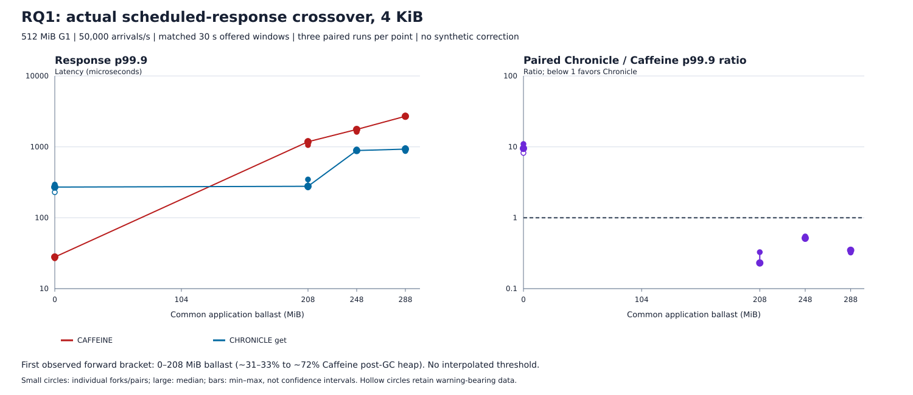
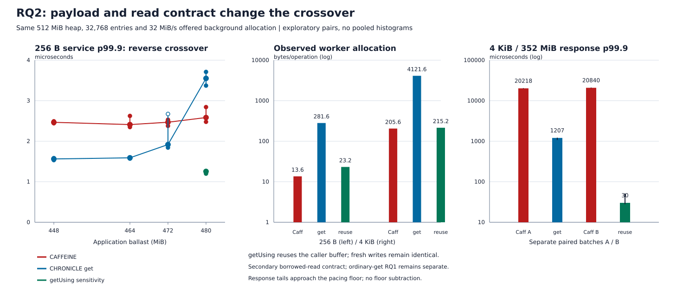

# Focused crossover results and researcher review — 8 November 2026

**The first useful RQ answers are complete. Collection is stopped.** At 4 KiB, ordinary Chronicle `get` has a reproducible advantage in **actual scheduled response p99.9** after pressure increases, but **no forward crossover in saturated service p99/p99.9 was observed** at the tested high-pressure points. At 256 B, service p99.9 crosses in the opposite direction: Chronicle starts lower and becomes higher near heap saturation. Buffer reuse reverses that disadvantage in a separately labelled sensitivity.

These are exploratory results answering where a useful effect exists and which endpoint sees it. They do not establish a universal occupancy threshold. All 132 workload JVMs completed, verified resident values and remain in the dataset, including warning-bearing forks. There were zero replacement forks, OOMs or censored arrivals. Historical Task 12 and AGY evidence retain their original classifications.

## RQ1: response crossover exists; ordinary service crossover did not reproduce

The scheduled experiment offers 50,000 requests/s to a single worker. Response is completion minus **intended arrival**, including backlog after a pause. Intended times never move after a stall, no overdue arrivals are skipped, and every offered request is accounted for. This differs from AGY's synthetic expected-interval histogram correction. Service is completion minus actual operation start; the saturated service experiment uses separate JVMs.

For matched 30-second offered windows, ordinary `get`, 4 KiB values and a fixed 512 MiB G1 heap:

| Common application ballast | Caffeine response p99.9 | Chronicle response p99.9 | Three paired Chronicle/Caffeine ratios |
| --- | --- | --- | --- |
| 0 MiB | 26.8–28.5 µs | 229–294 µs | 10.973, 9.516, 8.211 |
| 208 MiB | 1.060–1.205 ms | 0.268–0.347 ms | 0.327, 0.230, 0.227 |
| 248 MiB | 1.627–1.779 ms | 0.882–0.920 ms | 0.546, 0.501, 0.517 |
| 288 MiB | 2.671–2.757 ms | 0.873–0.959 ms | 0.323, 0.348, 0.348 |

**The observed forward response crossover is bracketed between 0 and 208 MiB ballast.** This corresponds to roughly 31–33% versus 72% measured Caffeine post-GC heap occupancy. It already occurs before the severe Full-GC region; the data do not support a universal “97% cliff.” No intermediate threshold is interpolated. At 352 MiB in the separate short-window batch, the advantage grows: Caffeine 19.79–20.40 ms versus Chronicle 1.075–1.222 ms, all three pairs.

For **saturated ordinary service**, all three pairs at each tested 4 KiB point—328, 352, 360, 364 and 368 MiB—favor Caffeine at both p99 and p99.9. At 368 MiB, Caffeine service p99.9 is 8.73–8.80 µs versus Chronicle 11.02–11.28 µs, even though Caffeine reaches about 99.3% post-GC occupancy and spends 66.5–70.1% of measured wall time in GC. Throughput then favors Chronicle: approximately 0.647–0.654 million operations/s versus 0.426–0.463 million/s.

This is not evidence that GC has little cost. At that point Caffeine has 313–333 measured Full GCs, but pause events are only about 0.018% of completed operations, below the 0.1% tail defining p99.9. Time lost to long pauses can dominate wall time while leaving an operation-weighted service percentile small. Queue-sensitive response and throughput expose the cost. This explains the endpoint disagreement without redefining the original service question after observing the results. No OOM occurred; a capacity-survival boundary was not located.

## RQ2: smaller values move the pressure region and can reverse the service ordering

Both payloads use the **same 512 MiB heap**, resident count, trace and offered background allocation. AGY's 256 B/256 MiB and 4 KiB/512 MiB discovery configurations are useful for choosing regions, but are not a controlled payload-only comparison.

| 256 B ordinary saturated service | Paired Chronicle/Caffeine p99.9 ratios | Observation |
| --- | --- | --- |
| 448 MiB ballast | 0.635, 0.634, 0.628 | Chronicle lower in all pairs |
| 464 MiB | 0.677, 0.609, 0.652 | Chronicle lower in all pairs |
| 472 MiB | 0.775, 0.758, 1.083 | Mixed; reversing pair has an outside-CPU warning |
| 480 MiB | 1.374, 1.186, 1.497 | Caffeine lower in all pairs |

The **same-runtime original batch establishes a reverse service crossover somewhere between 448 and 480 MiB**. Later midpoint batches suggest the transition is toward the upper end, but use the newer runner runtime described below; they do not justify a precise pooled threshold. At 480 MiB, Caffeine service p99.9 is 2.48–2.84 µs versus Chronicle 3.37–3.71 µs. In contrast, scheduled response at this point still favors Chronicle in all three pairs: about 1.20–9.85 ms versus Caffeine 18.96–18.99 ms. The large Chronicle spread remains visible.

Reaching comparable near-full Caffeine occupancy takes roughly 128 MiB more application ballast for 256 B than 4 KiB values (480 versus 352 MiB). The payload-footprint difference alone is 120 MiB for 32,768 entries. This is consistent with the pressure region moving with heap-resident payload size; it is not an exact or general crossover-threshold formula. At a common ballast and offered load, the backends' total occupancy is allowed to differ: equalizing it would remove the memory-saving mechanism under study.

## Read allocation explains a useful sensitivity, with a different ownership contract

The primary comparison keeps ordinary Chronicle `get`, which materializes a fresh value array. A separate `getUsing` arm borrows a caller buffer, checks the returned buffer's identity and uses the same fresh immutable write-generation rule. Tests verify that modifying the caller buffer does not change stored values.

| Sensitivity | Ordinary Chronicle | Chronicle `getUsing` | Interpretation |
| --- | --- | --- | --- |
| 256 B worker allocation | 281.6 B/op | 23.2 B/op | Read materialization largely removed; writes still allocate |
| 4 KiB worker allocation | 4121.6 B/op | 215.2 B/op | Caffeine is approximately 205.6 B/op for comparison |
| 256 B / 480 MiB service p99.9 | 3.37–3.71 µs | 1.20–1.26 µs | Reuse beats its own paired Caffeine controls in all three pairs, ratios 0.475–0.510 |
| 4 KiB / 352 MiB response p99.9 | 1.075–1.222 ms | 27.9–51.3 µs | Reuse beats its own paired Caffeine controls, 20.5–21.1 ms, in all three pairs |

Ordinary and reuse values above come from separate labelled batches; they are not histograms pooled across contracts. The reduction is strong evidence that read allocation matters under pressure. It does not isolate every internal cause or establish universal zero allocation. Reuse changes ownership semantics and cannot be substituted retroactively for ordinary-get RQ1. The smallest reuse response tails approach the measured pacing floor; no floor subtraction or bare-library latency claim is made. The proposed Caffeine-executor explanation for its 256 B baseline remains untested.

## Methods, warnings and independent review

The [pre-implementation plan and staged decisions](TAILCACHE_FOCUSED_REDO.md) record what each bounded batch was intended to resolve. Twelve batches contain 132 workload JVMs plus 36 tiny control JVMs. No batch has more than 24 workload JVMs. Active collection totals about **64 minutes**; workload collection ran from 12:48 to 14:05 IST on 8 November, with implementation/review gaps. All slots were preserved; no whole-study restart was used.

Shared inputs are 32,768 resident entries, a uniform 40,001-operation trace with approximately 95/5 reads/updates, seed 24301, Java 21, G1, fixed 512 MiB heap and a continuously running 32 MiB/s offered application-churn thread. The actual Caffeine capacity is 40,960, not an assumed 65,536. Closed-loop duration naturally produces different completed operation counts and cumulative write versions across backends; it shares the deterministic trace and fresh-value generation rule, not byte-identical final states after different numbers of updates. Arrival measurement windows have exact equal request counts. Each final state is verified against its own expected versions and resident count outside timing. Chronicle retains no heap payload bank.

Three small lifecycle trials precede each JVM's workload. Short batches use 8 s warmup / 2 s conditioning / 8 s measurement; long response batches use 12 / 2 / 30 s. Compiler deltas, all phase clocks, churn realization, allocation, host/power/thermal observations, complete GC logs, raw HDR histograms, exact classpath and source are retained. Analytics is explicitly disabled and checked. Chronicle storage is **in memory**; this follow-up makes no persisted cold/open/page-fault claim. Backend configuration, including tiering policy, is logged. Full GC and occupancy are computed only over actual measurement clocks, including any scheduled drain, never over setup or verification.

The harness's injected 20 ms stall produces approximately 19.3 ms scheduled-response p99.9 with all 50,000 control requests conserved. The timer-only response floor is about 20.8 µs in the initial control. Every-operation service/gap/response observations are consumed and recorded; none are clipped or corrected with synthetic samples. Raw compressed HDR distributions were decoded independently against exported bins. Percentile reconstruction uses the pinned HDR 2.2.2 rank rule.

Review findings and limits:

- **Endpoint integrity:** service, scheduled response, throughput and capacity survival answer different questions. Only the scheduled endpoint establishes the observed 4 KiB forward crossover. Do not advertise it as an ordinary service-tail crossover.
- **Replication and outliers:** three independent, counterbalanced pairs per point. All individual results and ranges remain visible; range bars are not confidence intervals. No trimming, percentile pooling, invented p-values or endpoint-based rejection.
- **External sensitivity:** 10 workload forks carry 11 warning flags: eight compiler-activity flags and three outside-CPU flags. [Warning sensitivity](../evidence-archives/focused-rq-results-20261108-001/warning-sensitivity.json) preserves every pair and also describes the warning-free subset. Main baseline/208 MiB response directions persist with two clean pairs at each point; all high-pressure service endpoint pairs and both original 256 B reverse-crossover endpoints are clean. At 472 MiB the two clean pairs favor Chronicle; the warned third reverses. Treat that midpoint as uncertain, not as a removable outlier.
- **Duration sensitivity:** the original 8 s, zero-ballast response batch has mixed ordering. It remains in the dataset. The explicitly declared fresh 30 s batch stabilizes baseline direction; report durations separately rather than silently replacing or pooling the short baseline.
- **Source matching:** the first four batches and later eight batches form two compiled-runtime groups after adding `getUsing` support. Every within-point backend pair is source matched. Ordinary `executeNext` logic is unchanged, but the runner gains a branch and common caller buffer. Both exact class sets are retained; the older 40-class set was reconstructed and all 40 hashes match its frozen protocol. RQ1's long response baseline and upper points share the same later runtime. The original 256 B 448/480 bracket shares the earlier runtime; cross-runtime midpoints are descriptive refinements.
- **Causal scope:** G1, one worker, one seed, one heap, one arrival rate and this host. This is a bounded discovery study, not a collector/concurrency/production-SLA generalization. Allocation and pause evidence support mechanisms; they do not isolate all implementation differences. No survival limit or universal occupancy cliff is established.

**Research decision:** the response-latency mechanism is worth pursuing; a larger confirmatory study should target these brackets and keep read ownership explicit. The original hypothesis that rising pressure must make ordinary Chronicle service p99/p99.9 beat Caffeine at 4 KiB is unsupported within this tested range. Both findings are usable results. Further collection is unnecessary for this first RQ-focused answer.

## Retained delivery

The [dataset](../evidence-archives/focused-rq-results-20261108-001/study.json), [132-row table](../evidence-archives/focused-rq-results-20261108-001/forks.csv) and [audit](../evidence-archives/focused-rq-results-20261108-001/audit.json) sit outside `build`. The audit verifies 3,960 retained inventory files, independently reconciles 132 measured GC windows and 1,008 percentile endpoints, and records 504 decoded HDR distributions across workload and controls. Fifty Java tests and 211 Python tests passed during implementation. Final reporting adds no benchmark-source change.

Both exact compiled runtimes, all 27 dependency jars and one resource file, original source archives, executed analysis source, warning sensitivity, and standalone SVG/PNG figures are retained. The sibling `focused-rq-delivery-20261108-001.tar.gz` bundles the twelve batch directories and synthesis with a read-back-verified file manifest. This is a local preservation bundle, not an independent off-host backup. Historical acceptance records and AGY changes remain untouched. The recovery timer remains stopped.
