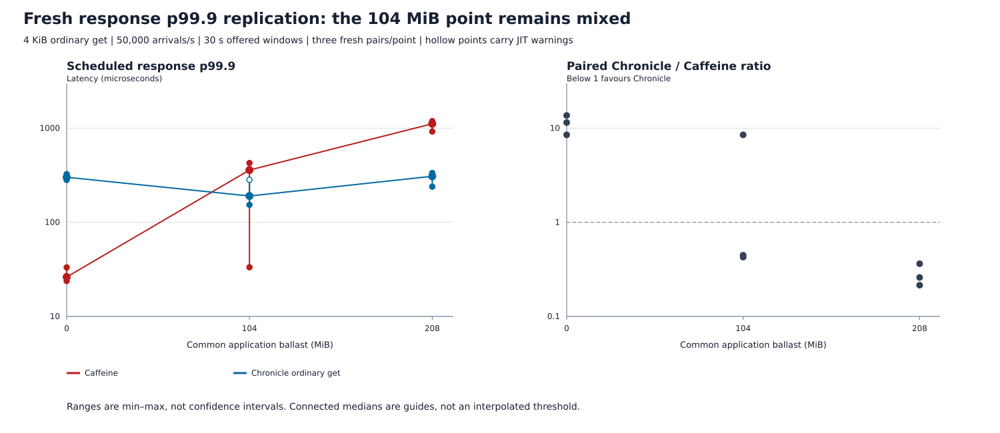
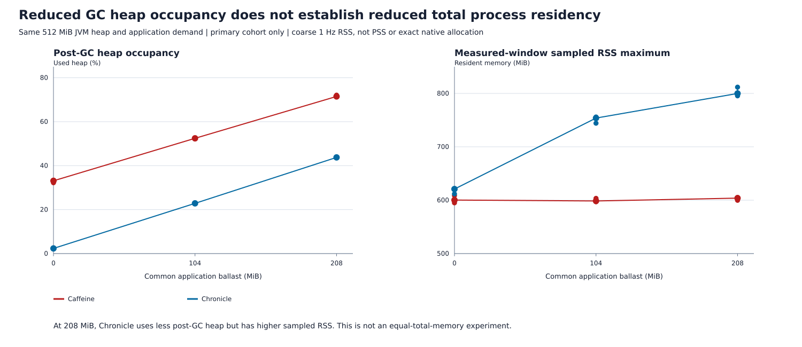

# Fresh midpoint and seed replication: results and researcher review

> **Presentation review — 15 November:** these measurements and their acceptance are unchanged. The [manuscript](preprint/MANUSCRIPT.md), [reviewed claim map](preprint/CLAIMS.md), [current state](TAILCACHE_CURRENT_STATE.md) and [protected explorer](https://tailcache-results.vercel.app/#review-update) now incorporate the deep review. It tightened timing/payload inference and verifier coverage; it did not collect new forks or turn mixed 104 MiB into a resolved threshold.

Run recorded **10 November 2026**. Collection: **19:20–19:46 Asia/Kolkata**, approximately 26 minutes. **30 workload JVMs plus nine controls**, no replacement forks. All workload JVMs completed with verified values and 1,500,000 scheduled responses apiece; no OOM or censored arrivals. No additional adaptive point was collected.

[Interactive follow-up](TAILCACHE_MIDPOINT_EXPLORER.html) · [Integrated explorer](TAILCACHE_RESULTS_EXPLORER.html#midpoint-followup) · [Audited dataset](../evidence-archives/midpoint-results-20261110-001/study.json) · [All 108 percentile conclusions](../evidence-archives/midpoint-results-20261110-001/conclusions.csv) · [Threshold counts](../evidence-archives/midpoint-results-20261110-001/stall-rates.csv) · [Audit](../evidence-archives/midpoint-results-20261110-001/audit.json)

## Main answer

**The 0-to-208 MiB scheduled-response p99.9 direction change repeats, but the new 104 MiB point remains unresolved.** Both additional workload seeds repeat the endpoint directions and disagree with each other at 104. We therefore retain the **0–208 MiB bracket**. Do not interpolate a precise crossover or narrow it using a median that hides contrary pairs.

All rows below concern 4 KiB ordinary get, a fixed 512 MiB G1 heap,32,768 entries, uniform approximately 95/5 reads/updates,32 MiB/s offered application churn, one worker and50,000 scheduled requests/s. Warmup/conditioning/offered measurement are12/2/30 seconds. Common retained application ballast is shared across backends; observed heap occupancy is not equalised.

| Ballast | Primary Caffeine response p99.9 | Primary Chronicle response p99.9 | Three paired Chronicle/Caffeine ratios | Conclusion / warning-free coverage |
| --- | --- | --- | --- | --- |
|0 MiB|23.82–33.18 microseconds|281.86–325.12 microseconds|11.474,8.494,13.647|Caffeine lower in all 3;3/3 clean pairs|
|104 MiB|33.31–426.24 microseconds|153.34–283.14 microseconds|0.427,0.447,8.500|Mixed;1/3 clean pairs|
|208 MiB|0.921–1.189 milliseconds|0.239–0.334 milliseconds|0.215,0.363,0.259|Chronicle lower in all 3;3/3 clean pairs|

Ranges are across individual forks, not confidence intervals. Three matching directions are a descriptive replication criterion, not a significance test.

## Additional seeds: useful limited robustness

Each additional seed has **one pair per point**, not three. Keep these cohorts separate from the primary repetitions and from historical data.

| Workload seed | Ratio at 0 MiB | Ratio at 104 MiB | Ratio at 208 MiB | Interpretation |
| --- | --- | --- | --- | --- |
|24302|9.267|2.873|0.340|Caffeine lower at 0/104; Chronicle lower at 208. Baseline and208 pairs carry JIT warnings.|
|24303|12.140|0.816|0.285|Caffeine lower at 0; Chronicle lower at 104/208. Baseline pair carries a JIT warning;104/208 are clean.|

The two **clean104 MiB seed observations disagree**, so compiler warnings alone do not explain away the unresolved transition. One pair per seed does not provide precise seed-level uncertainty or establish a universal seed effect.

The adaptive rule was frozen before collection: choose52 or156 MiB only from three complete, warning-free primary pairs per point with consistent opposite endpoint directions. The104 point was mixed and warning-bearing, so the controller correctly skipped further bisection. No rule was relaxed after seeing the results and no noisy fork was replaced.

## Why104 MiB can flip at p99.9

In the primary Caffeine forks at 104, response probability above100 microseconds is **0.1124%,0.11367%,0.09273%**. The first two exceed the 0.1% tail boundary associated with p99.9; the third does not. Accordingly, its p99.9 shifts from 359/426 microseconds to33 microseconds. These are exact threshold counts for these histograms, not confidence intervals.

The third pair is not grounds for outlier removal. The distributions, short observation windows, compiler activity and GC exposure all remain available. The count-frequency observation explains how a percentile can move sharply; it does not identify a unique cause of each stall. Aggregate GC pause totals do not establish operation-by-operation attribution.

## Higher percentiles and the full tail

At scheduled-response **p99.99 and p99.999**, Chronicle is lower at all three pressure points in the primary cohort and in each single-pair seed cohort. The baseline advantage therefore repeats; it is **not** a newly emerging pressure crossover at those endpoints.

Each complete30-second scheduled fork has1.5 million responses, with only about 15 nominal observations in the upper0.001%. Responses can share a pause, so those observations are not independent stall episodes. All three channels, four requested percentiles and strict >100 microsecond/>1 millisecond/>10 millisecond counts are exported. Every valid channel's full retained HDR bins are available; no pooling, trimming, smoothing of the underlying data or floor subtraction was used.

Service and gap measurements here belong to the **scheduled-arrival workload**. They must not be substituted for the earlier saturated service runs. The historical ordinary-service findings and original RQ definitions remain unchanged.

## New resource observation: heap savings are not total-memory savings

| Primary ballast | Post-GC used heap, Caffeine / Chronicle | Measured sampled RSS maximum, Caffeine / Chronicle |
| --- | --- | --- |
|0 MiB|32.2–33.3% /2.3%|595–609 /612–621 MiB|
|104 MiB|52.1–52.5% /22.9%|597–603 /744–756 MiB|
|208 MiB|71.5–72.1% /43.8%|600–605 /796–812 MiB|

Chronicle lowers the GC-managed retained heap while using **higher measured process residency** in this configuration, especially at 104/208. This qualifies any claim that moving values off heap “saves memory.” RSS includes the JVM and resident native/file-backed pages;1 Hz samples are coarse, not PSS or exact native-allocation accounting. We have not isolated the contribution of map capacity, heap commitment or other native structures, and this is not an equal-total-memory-budget experiment.

Ordinary read materialisation remains visible: approximately 4,121.6 worker B/op for Chronicle versus205.6 for Caffeine, alongside the common offered background churn. The fresh cohort does not use getUsing, persistence or another collector.

## Integrity, qualification and acceptance

- All68 compiled runtime files and the classpath match the retained later-runtime8 November response-bracket cohort. The measured Java code was unchanged. Python added explicit seeds, cheap resident-memory records and stronger resume/child identity handling. Observer effects remain a limitation; equal runtime does not establish recorder neutrality.
- Native exclusive scope/lock and actual JVM cgroup identity were retained. Mount/filesystem/storage, CPU/JVM/Git metadata and host/power/thermal records accompany each cohort. No host-gate warnings occurred in the 30 workload forks. Chronicle analytics is disabled; tiering policy remains explicitly logged.
- Five workload forks carry the declared **>80 ms measured compiler-activity warning**. At primary104 these are Caffeine pair1 (505 ms) and Chronicle pair3 (191 ms). They remain visible in inclusive results; the clean subset has only one primary pair. No claim is made that every fork achieved compilation-free steady state.
- The nine floor/injected-stall controls passed their integrity and request-conservation checks. They are diagnostic controls, not30-second confidence bounds or quantities to subtract from workload percentiles.
- Independent Java decoding checked117 compressed distributions including controls; the full-tail audit independently checked270 workload threshold cases. Python and Java agree on all requested percentile endpoints and all bin/count bounds. Thirty raw-GC reconciliations passed;720 per-fork raw hashes and1,008 batch inventory entries verified. All four historical delivery archives remain byte-identical.
- The collection controller recorded source unchanged at completion, hash `782a41005d94954297debf9d4e2560a8f71cc3db496dc464f23efb01d7783dd0`. Source archives, exact seed/order schedules and runtime-file copies are retained. Post-collection reporting changes are separate from measured-source identity.

**Acceptance:** accept this complete **exploratory replication dataset**, with explicit JIT limitations and an unresolved104 MiB transition. The clean primary endpoint pairs strengthen the tested 0–208 MiB response bracket. Single-pair seed checks are descriptive robustness. The original unconditional Task12 protocol remains unqualified; no new result changes its historical acceptance or stopping-policy amendment. This review is an agent research-method review, not independent human peer review.

## Decision for the preprint

The bounded follow-up is finished. It strengthens the existence of the workload-specific response direction change, shows why a sharp threshold would overstate the data, and adds a material process-memory tradeoff. Further blind bisection is not justified by this result. Proceed to manuscript/figure and claim review. An equal-total-memory or different-load study is a separately declared future experiment, not required to finish this unit.
