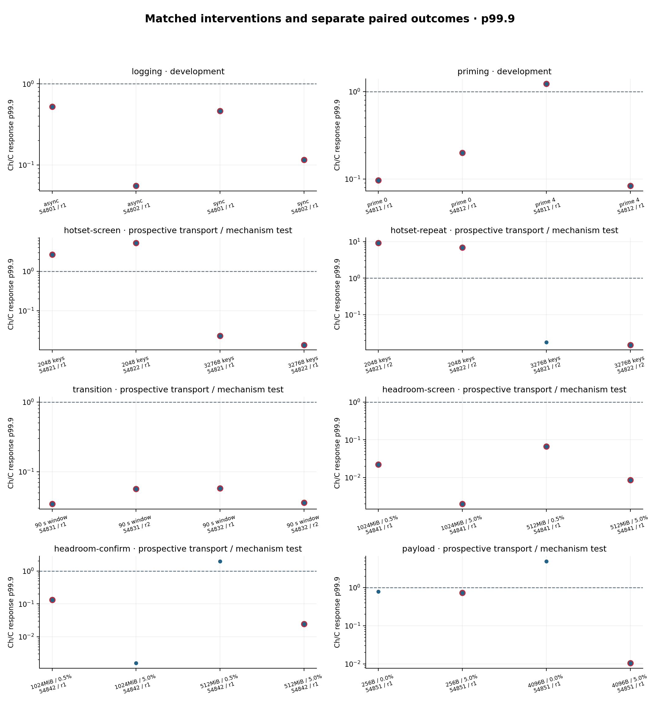
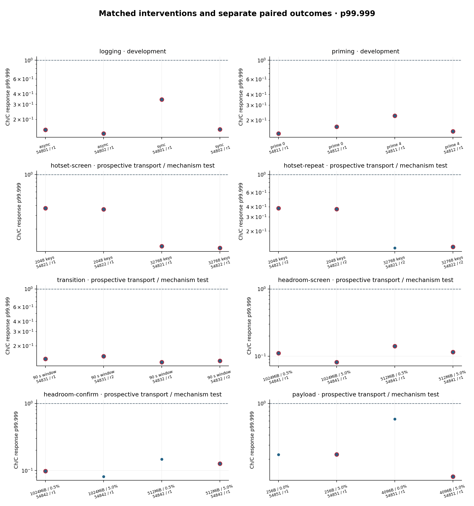
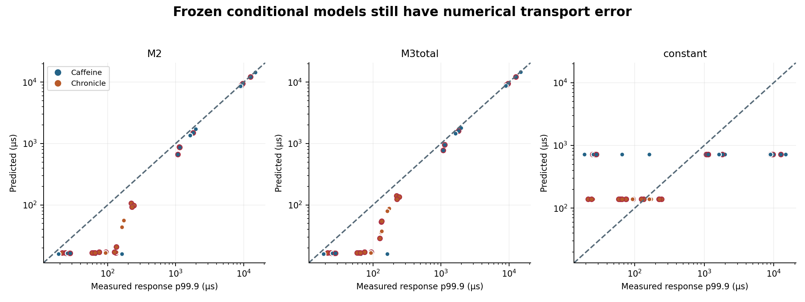

# Mechanism figures

**Figure C1. Matched interventions and separate paired outcomes · p99.9.** Each dot is one retained paired fork; below1 favors Chronicle, above1 Caffeine. Red outlines retain warnings. Each panel uses different interventions; no quantile pooling, fitted crossing or confidence interval. Development logging/priming are separate from transport tests. Repeated hotset seeds are not fresh confirmation. Extreme-tail observations can share stalls;90-second transition measurements remain separate from30-second cohorts.

**Figure C2. Matched interventions and separate paired outcomes · p99.999.** Each dot is one retained paired fork; below1 favors Chronicle, above1 Caffeine. Red outlines retain warnings. Each panel uses different interventions; no quantile pooling, fitted crossing or confidence interval. Development logging/priming are separate from transport tests. Repeated hotset seeds are not fresh confirmation. Extreme-tail observations can share stalls;90-second transition measurements remain separate from30-second cohorts.

**Figure C3. Frozen conditional models still have numerical transport error.** All calibrated4KiB forks after logging/priming development are shown, including warnings and collector failures. The fixed GC-only and broader-safepoint FIFO reconstructions use observed pauses; the constant pilot baseline does not. No parameters are fitted here. Contrasts across multiple interventions are descriptive; per-cohort/per-backend numerical summaries remain authoritative. M3core is also retained/scored in the portable package; showing M3total is not an after-data model selection.

