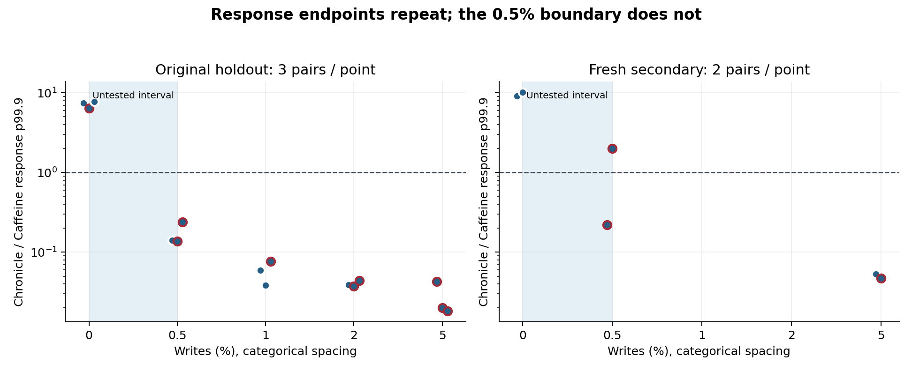
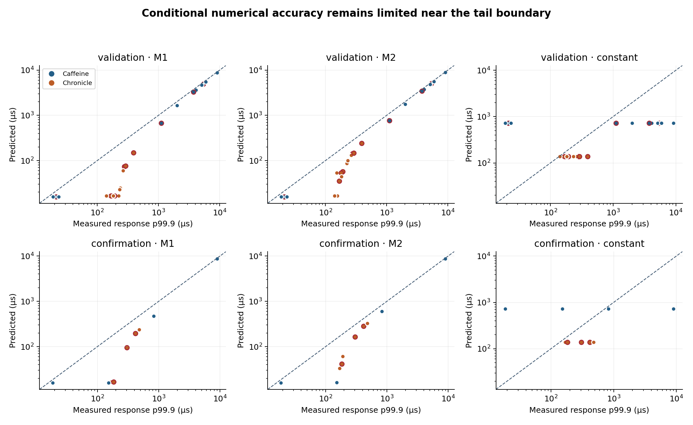
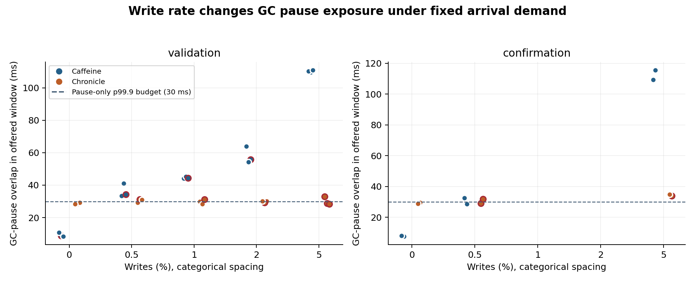
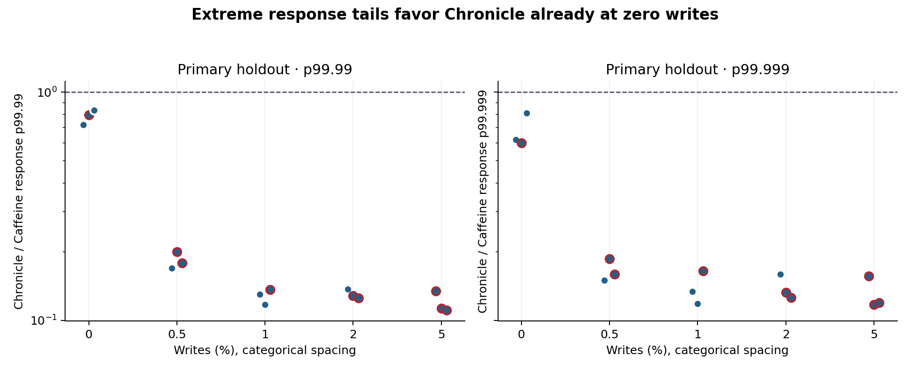

# Continuous-stream prediction study figures

**Figure B1. Response endpoints repeat; the 0.5% boundary does not.** Every dot is one complete paired comparison, with red outlines for any recorded warning; no percentiles are pooled. Shading marks the primary observed0–0.5% bracket. Fresh0.5% pairs disagree; only0%/5% endpoint directions repeat. Shading is not a confidence bound or exact threshold. The original before-run0.5–2% bracket forecast failed. Fresh secondary repetitions are plotted separately. All observations retain transient qualification; categorical spacing avoids implying a fitted response curve.

**Figure B2. Conditional numerical accuracy remains limited near the tail boundary.** M1 and M2 use this run's observed GC intervals, not an ex ante GC forecast. M2 and the additional constant-quantile baseline use pilot calibration; the constant comparator was specified after primary outcomes, before fresh confirmation. Diagonal indicates exact agreement. Every fork, including warnings, is shown; blue Caffeine/orange Chronicle. No below-threshold outcome is excluded.

**Figure B3. Write rate changes GC pause exposure under fixed arrival demand.** Pause-only budget is0.1% of the30-second window. It determines whether ideal residual pause delay can exceed zero, not a complete latency value or universal transition. Chronicle response can exceed a baseline even with pause sum below this line because queue drain, baseline work and non-GC stalls remain. Paired library configurations differ in more than value placement. All forks and warnings remain included.

**Figure B4. Extreme response tails favor Chronicle already at zero writes.** All15 primary pairs are shown separately at each percentile. This is an already-present extreme-tail advantage, not a newly pressure-induced crossing. p99.999 has about15 nominal observations in the upper tail per1.5-million-response fork; several can share a stall. The same forks contribute both panels, so these are dependent endpoints. Secondary holdout results remain available in the data/table and explorer.

