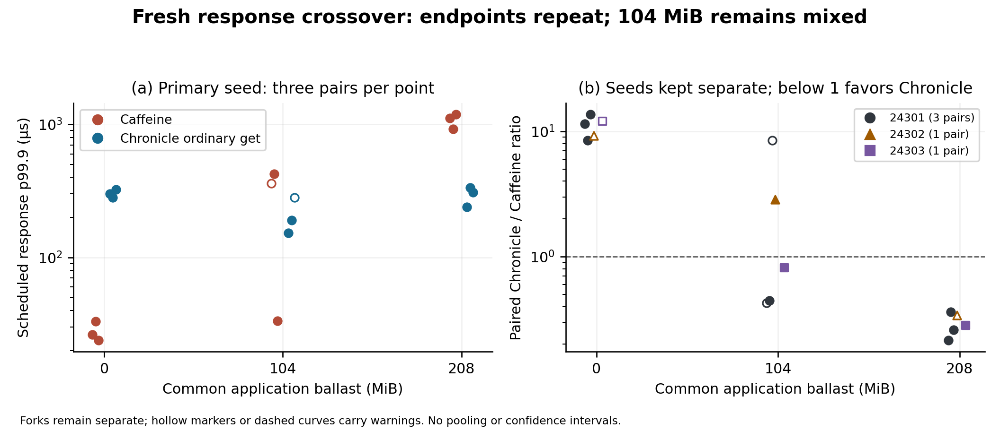
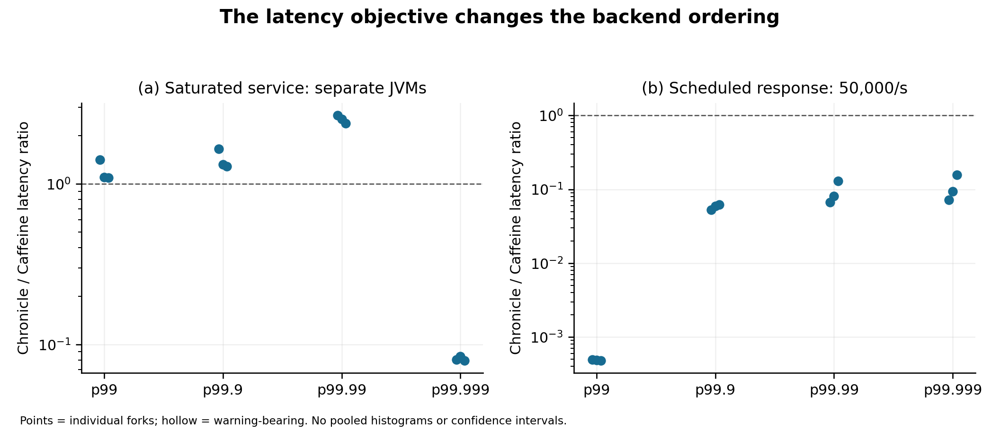
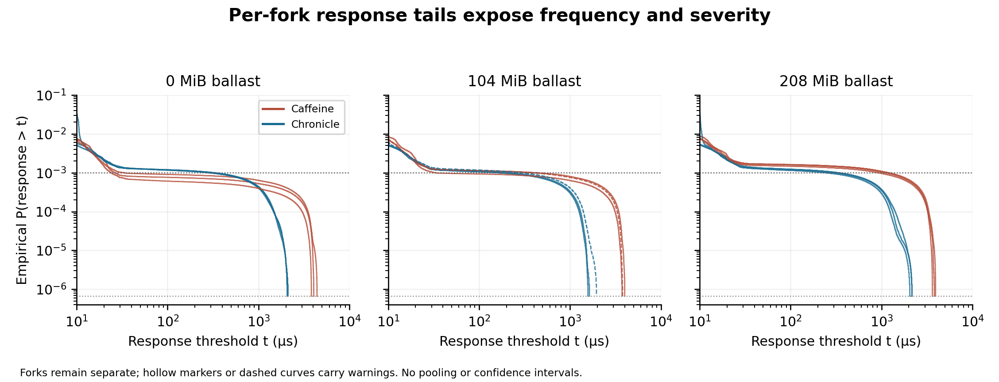
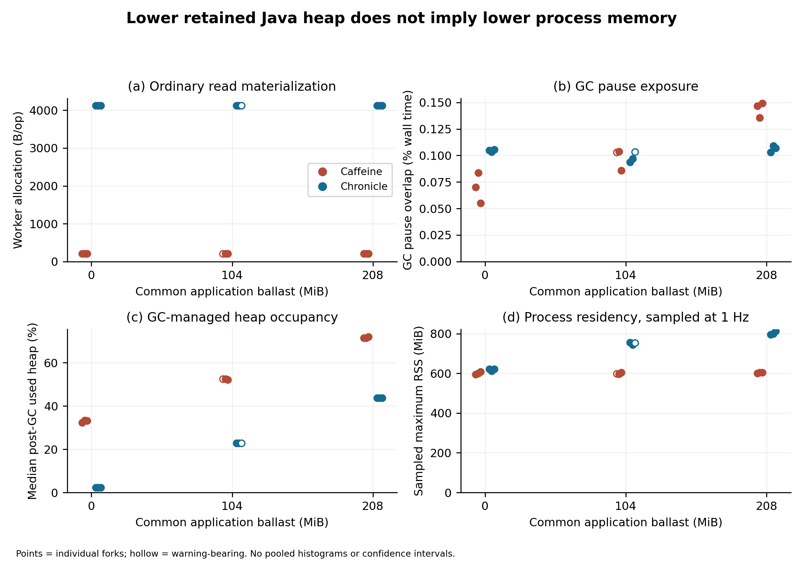
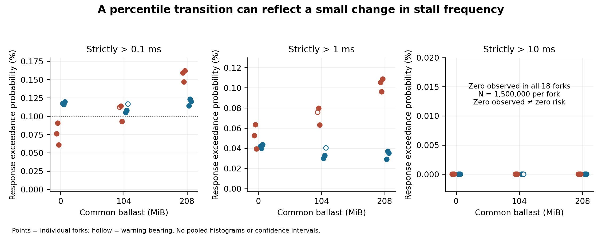
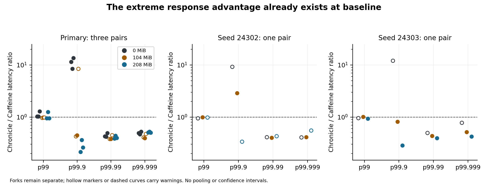
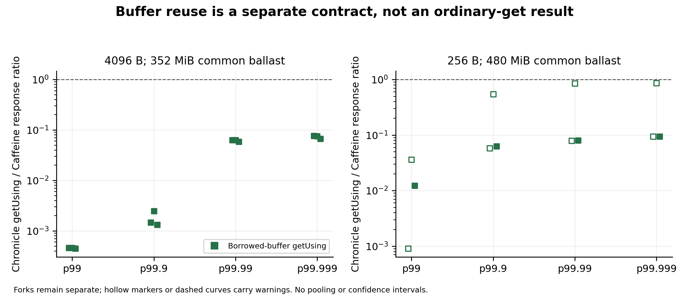

# Paper figures and captions

## Preprint figures

1. [Cross-host locality](figures/fig08_cross_host_locality.svg) shows all 20
   paired ratios of Chronicle to Caffeine scheduled-response p99.9.
   [Exact fork pairs](locality-pairs.csv)
2. [Time in G1 mixed collections](figures/fig09_mixed_collection_time.svg)
   compares the eligible write sets on the second host at 30 and 90 seconds.
   Both panels use the same vertical scale.
3. [Saturated service by payload](figures/fig10_saturated_payload.svg) shows
   the 16 first-pass pairs at 5% writes, split by payload and added application
   data. A ratio of 1 marks equal latency.
4. [Scheduled response by added heap data](figures/fig11_response_pressure.svg)
   compares the earlier short replay and newer full-key workload at the same
   vertical scale. Each dot is one measured fork.

Filled marks show warning-free pairs and open marks show warning-bearing
pairs. The [interactive companion](../../output/html/tailcache-preprint-reader.html)
lets readers explore the chart inputs. The figures below retain their earlier
numbering and scope.

Vector PDF and SVG plus 240 dpi PNG are supplied. Figures 1–6 are candidate main-text figures; Figure 7 is an appendix sensitivity. Final manuscript placement remains author review.

## Figure 1. Fresh response crossover: endpoints repeat; 104 MiB remains mixed

4 KiB ordinary get, 512 MiB G1 heap, 50,000 intended arrivals/s, 30 s offered windows. Each marker is a fork (a) or paired ratio (b); horizontal offsets separate observations and do not change ballast. Primary endpoint pairs are clean. At 104 MiB only one primary pair is clean; the two clean additional-seed observations disagree. No curve or exact crossover threshold is fitted.

[PDF](figures/fig01_response_replication.pdf) · [SVG](figures/fig01_response_replication.svg)

## Figure 2. The latency objective changes the backend ordering

Historical earlier-runtime cohort only: 4 KiB, 352 MiB common ballast, 8 s windows, three pairs per regime. Saturated service and scheduled response use separate JVMs; they are not interchangeable measurements of one run. Points are paired quantile ratios, not ratios of pooled quantiles. Higher percentiles were computed post hoc from retained histograms. No measured compiler warnings occur in these selected forks.

[PDF](figures/fig02_estimands.pdf) · [SVG](figures/fig02_estimands.svg)

## Figure 3. Per-fork response tails expose frequency and severity

Fresh primary cohort, three curves per backend per point. Curves preserve every occupied HDR upper-bin boundary in the displayed domain; no pooling or smoothing. Dashed curves carry warnings (rather than the marker convention used elsewhere). P(response > t) is exact for the retained binned distribution at upper boundaries. Dotted horizontal lines mark 0.1% and 1/N (N=1,500,000); they are not confidence bounds. Zero survival beyond a fork maximum is omitted on the logarithmic axis, not replaced with an invented probability. The left edge truncates ordinary fast responses.

[PDF](figures/fig03_full_tails.pdf) · [SVG](figures/fig03_full_tails.svg)

## Figure 4. Lower retained Java heap does not imply lower process memory

Fresh primary cohort. GC exposure is pause overlap with the measurement envelope divided by measured duration. Worker B/op excludes the independently offered common churn; heap occupancy is a post-collection summary, not an exact live-object census. RSS is coarse measured-window process residency, not PSS, native allocation or an equal-total-memory comparison. Allocation and GC are consistent mechanism evidence, not per-operation causal attribution.

[PDF](figures/fig04_resources.pdf) · [SVG](figures/fig04_resources.svg)

## Figure 5. A percentile transition can reflect a small change in stall frequency

Fresh primary response histograms. Points and vertical segments show definite–possible strict exceedance probabilities from HDR bin resolution; these are not statistical intervals. At 104 MiB Caffeine >100 µs rates straddle the 0.1% boundary that defines p99.9. The >10 ms panel reports zero observations with the denominator visible. Rates count responses, not independent pause episodes. Exact counts and all seed cohorts are in fresh-stall-rates.csv.

[PDF](figures/fig05_stall_probabilities.pdf) · [SVG](figures/fig05_stall_probabilities.svg)

## Figure 6. The extreme response advantage already exists at baseline

All fresh seed cohorts shown separately. Paired Chronicle/Caffeine response ratios at p99 through p99.999, not an interpolated curve. At p99.99 and p99.999 every fresh pair favors Chronicle, including 0 MiB. A 30 s fork contains 1.5 million responses and only approximately 15 nominal upper-tail observations at p99.999; correlated queued responses do not establish independent stall counts.

[PDF](figures/fig06_percentile_sensitivity.pdf) · [SVG](figures/fig06_percentile_sensitivity.svg)

## Figure 7. Buffer reuse is a separate contract, not an ordinary-get result

Historical later-runtime sensitivity batches, 8 s scheduled response at 50,000/s, three paired blocks comparing Caffeine with Chronicle getUsing. There is no contemporaneous ordinary-Chronicle arm in these batches. The panels use different payloads AND different ballast, and therefore are not a payload-only causal comparison. Reuse permits a caller buffer to be overwritten by the next read. Extreme endpoints are post hoc. This figure is suitable for the appendix.

[PDF](figures/fig07_ownership_sensitivity.pdf) · [SVG](figures/fig07_ownership_sensitivity.svg)
