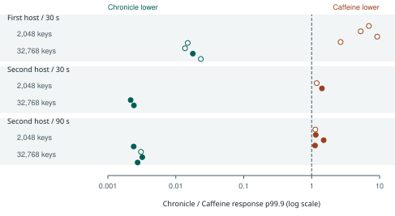
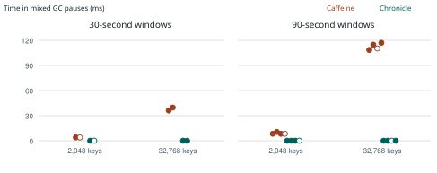
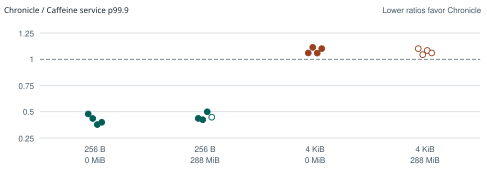
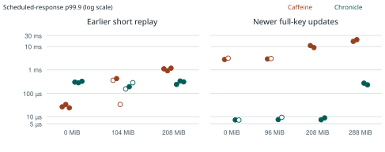

# Same Write Rate, Different Winner: How Update Locality Reverses Tail-Latency Rankings in Java Caches

22 November 2026

## Abstract

Java applications use caches to avoid repeated work. Storing cached values outside the Java heap reduces how much cached data stays live on the Java heap, while a read can require a fresh copy of the value. We compare Caffeine and in-memory Chronicle Map to determine how this trade-off affects cache-call latency and response time under scheduled arrivals.

We ran both caches with 32,768 entries, 4 KiB values, 5% writes, 50,000 intended arrivals/s, and zero added application data. With 2,048 eligible write keys, Caffeine had the lower response p99.9. When all keys were eligible, Chronicle had the lower response p99.9. This reversal repeated on two machines. On the second machine, the 30-second full-key runs gave response p99.9 of 3.09-3.65 ms for Caffeine and 7.48-7.90 µs for Chronicle. Most of Caffeine's additional pause time in the full-key runs came from G1 mixed collections.

In a separate 48-pair experiment that timed cache calls back to back, Chronicle led at 256 B and Caffeine led at 4 KiB across the tested heap pressures and write rates. These results show that the cache choice can depend on which keys receive writes, how large the values are, and whether latency includes the time a request waits before its call begins.

## 1. Introduction

Caffeine is an in-process Java cache library. It stores entries on the Java heap, the memory managed by Java's garbage collector, and supports eviction when the cache reaches a configured size [1]. Chronicle Map is a concurrent Java key-value store that keeps entries outside the Java heap. It supports in-memory and file-backed storage [2].

In this study, we compare size-bounded Caffeine with in-memory Chronicle Map using the same byte-array values and workload. A Caffeine hit returns the array already in the cache. An ordinary Chronicle hit allocates a new Java array and copies the stored value into it. The time spent making that copy can affect the duration of a call. Garbage collection can also make a request wait before its call begins. We measure both so that a faster call does not hide a slower response.

We first ask whether adding application data to the Java heap causes a crossover at service p99 or p99.9 (**RQ1**), and whether changing the value size changes the ranking (**RQ2**). We then test whether changing the set of keys eligible for writes can reverse the scheduled-response ranking at the same arrival and write rates (**RQ3**). The last experiment was repeated on a second machine to check whether the direction held when the hardware and runtime changed.

## 2. Related work

Prioritized garbage collection provides explicit runtime support for the competing retention and collection costs of software caches [3]. A practitioner comparison of Caffeine and OHC already demonstrates that cache size and collection costs can change the preferred storage placement [4]. TeraHeap tackles related materialization and memory-pressure costs through a new heap design [5]. Our contribution is a specific empirical comparison of existing cache configurations at matched fresh-write demand, with a controlled update-set intervention and independent hardware replication.

Open and closed workload models can yield materially different latency results [6]. We apply that distinction to the measurement boundary of a cache call and a scheduled request. Java warmup and steady state are also known sources of experimental error [7]. We report compilation warnings, earlier qualification failures, and warning-free sensitivity alongside the measurements. Prior collector studies motivate examining application latency alongside pause summaries [8].

## 3. Methods

### 3.1 Cache semantics and timing

We use Java 21, Caffeine 3.2.4, Chronicle Map 2026.1, and HdrHistogram 2.2.2. Chronicle uses its ordinary get API [9]. Both configurations start with 32,768 resident entries and allocate a fresh immutable byte array per measured overwrite. Reads hit resident entries. Cache placement, layout, and maintenance differ across the two libraries. The experiments use one cache worker and allow JVM and library helper threads.

We measure service latency from the start of a cache call until it finishes. In the saturated experiment, the worker starts the next call as soon as it finishes the previous one. For scheduled response, we measure from the time a request was due until its call finishes. We schedule one request every 20 µs at 50,000 arrivals/s and run overdue requests in order. A garbage-collection pause can therefore delay requests whose calls have yet to start. The in-process schedule measures one worker serving hits and overwrites. The p99.9 is the latency at roughly the boundary of the slowest one in 1,000 operations.

### 3.2 Locality intervention and replication

We generate reads and writes from a seeded stream so that each backend receives the same workload for a given seed. Reads sample all 32,768 keys uniformly. Writes can replace a value within a fixed set of 2,048 keys or across all 32,768 keys. Both treatments use 4 KiB values, 5% nominal writes, G1, a fixed 512 MiB heap, zero added application data, and 32 MiB/s of offered background allocation. At about 2,500 writes/s, the expected time between overwrites of a key is 0.82 s in the smaller set and 13.1 s in the full set. Those intervals describe replacement in the workload. Individual values can survive for different durations.

On the first Linux host, which has an Intel Core i7-8750H (6 cores, 12 logical CPUs), we used two seeds and repeated each with the backend order reversed. The second Linux host has an AMD Ryzen 7 5800X (8 cores, 16 logical CPUs) and runs Temurin 21.0.13+9 with a 12-CPU JVM budget. Its 30-second replication uses two fresh seeds, and a separate 90-second cohort uses four additional seeds. Both hosts use 120 seconds of warmup and four seconds of conditioning with zero priming for the locality result. Host, JVM build, seed, and window length differences limit comparisons of effect magnitude. We keep each cohort and pair separate.

### 3.3 Pressure, write-rate, and quality checks

The second-host saturated matrix varies payload (256 B or 4 KiB), added strongly retained application data (0 or 288 MiB), and nominal writes (1%, 5%, or 10%), with four pairs per cell. Application ballast is retained data independent of cache contents. Zero ballast still includes the resident cache and temporary allocations. We fix the offered rate of background allocation (churn) and report when it cannot be sustained. Saturated backends can complete different numbers of operations. The separate paced sweep varies writes from 0.5% to 2% with 4 KiB values, all 32,768 keys eligible, zero added ballast, and four seed pairs per cell.

Each comparison pairs two JVM runs within a seed and workload. We report individual fork quantiles and descriptive ranges. We preserve warnings, including compilation, external CPU activity, and dropped churn. The second-host native observer handoff tightened process attribution before the 48-pair saturated matrix. One eligible external-noise pair was rerun and is included only in a separate warning-free sensitivity view. The original observations remain intact.

## 4. Results

### 4.1 Write locality reverses scheduled-response p99.9 on two hosts

Figure 1 shows the response p99.9 for all 20 paired comparisons. In every cohort, Caffeine leads when writes target 2,048 keys and Chronicle leads when writes target all 32,768. On the first machine, we repeated each seed with the backend order reversed. On the second machine, we used fresh seeds and checked the result again with 90-second measurement windows.

**Figure 1.** Each dot is one paired seed and run block. Ratios below 1 favor Chronicle. Filled dots indicate pairs with zero recorded warnings. Open dots retain measured pairs with warnings.

| Host and window | Write keys | Caffeine p99.9 | Chronicle p99.9 | Warning-free pairs |
| --- | ---: | ---: | ---: | ---: |
| First, 30 s | 2,048 | 24.75-28.06 µs | 74.82-244.10 µs | 0/4 |
| First, 30 s | 32,768 | 8.90-9.70 ms | 125.38-226.56 µs | 1/4 |
| Second, 30 s | 2,048 | 6.42-6.53 µs | 7.61-9.26 µs | 1/2 |
| Second, 30 s | 32,768 | 3.09-3.65 ms | 7.48-7.90 µs | 2/2 |
| Second, 90 s | 2,048 | 6.44-8.13 µs | 7.24-9.66 µs | 3/4 |
| Second, 90 s | 32,768 | 2.90-3.20 ms | 7.50-9.43 µs | 3/4 |

When writes reach all keys, the second-host 30-second runs give Caffeine a service p99.9 of 6.36-7.42 µs and a response p99.9 above 3 ms. Chronicle's response p99.9 stays near 8 µs. Caffeine's calls are still fast once they begin. The difference between the call and response measurements is consistent with requests spending more time waiting for the worker.

Caffeine's measured GC pause overlap increases from 8.21-9.91 ms with concentrated writes to 59.57-65.13 ms with distributed writes. Chronicle remains at 12.79-13.15 ms. Within each backend and seed, measured allocation per operation is unchanged by the treatment.

Figure 2 groups archived GC pauses by recorded type and shows that Caffeine's time in G1 mixed collections rises from 3.90-4.03 ms to 36.14-39.68 ms in the 30-second runs and from 8.27-10.47 ms to 108.53-117.04 ms in the 90-second runs. Both backends record zero full collections in these locality windows.

**Figure 2.** Each point is one fork. Both panels use the same scale. Open marks belong to pairs with recorded warnings. Chronicle's mixed-collection time is zero in these runs.

One explanation is that spreading writes out gives more Caffeine values time to reach the old generation before they are replaced. While the cache holds a value, that value is live. A later write can make the former value unreachable so that it can be reclaimed. G1 mixed collections reclaim young regions and selected old regions [10]. The increase in mixed pause time is consistent with longer-lived values being repeatedly replaced. Our measurements do not track individual objects through promotion, and changing where writes land can also change the work done by the cache policy.

The extreme tail has exceptions. Chronicle leads at scheduled response p99.99 and p99.999 in three of four 90-second pairs in each update-set arm. The two contrary Chronicle forks have completion gaps of 18.783 ms and 19.730 ms without overlapping logged GC pauses or JVM safepoints. At 30 seconds, roughly 15 operations lie beyond the nominal p99.999 rank per fork, and several affected operations can come from a single stall.

### 4.2 Payload changes the saturated-service ranking

At p99 and p99.9, Chronicle leads every 256 B pair (24/24) and Caffeine leads every 4 KiB pair (24/24), at both tested pressure endpoints and at all three write fractions. Of 48 first-pass pairs, 36 have zero recorded warnings. The external-noise rerun yields 37 pairs in the warning-free sensitivity view and preserves the direction at that cell. At 4 KiB and 288 MiB, all pairs at 5% and 10% writes have dropped churn demand. The direction there rests on warning-inclusive evidence. A robust pressure-induced p99 or p99.9 crossover remains unestablished.

**Figure 3.** First-pass pairs at 5% writes. Each point is a Chronicle-to-Caffeine p99.9 ratio. The dashed line marks equal latency. Open marks indicate a recorded warning in either run of the pair.

To understand the 256 B result, we compare reads at 5% writes and zero added heap data. The median of the four fork-level read p50s is about 0.10 µs for each cache. At read p99.9, Chronicle takes 0.65 µs and Caffeine takes 1.80 µs. The gap appears among the slower reads even though Chronicle copies the value. Earlier experiments with different Caffeine policies and JMH measurement settings changed the small-value ranking. The results establish the advantage for this configuration, while the cost of each step in the read path remains unresolved.

At 4 KiB, the value is 16 times larger. With the same write rate and added heap data, the median read p50 is 0.13 µs for Caffeine and 0.59 µs for Chronicle. Across reads and writes, Chronicle allocates about 4,122 bytes per operation and Caffeine allocates about 206. Both measurements are consistent with the higher cost of creating and filling larger arrays on ordinary Chronicle reads. We timed the complete call, so the measurements cannot assign a fraction of the difference to copying, allocation, lookup, or policy work.

### 4.3 A write-rate bracket and the limits of pause-based prediction

In the separate second-host paced sweep, every pair at 1.25% writes favors Caffeine and every pair at 1.5% favors Chronicle. All eight pairs across those two settings are warning-free. The 0.75% and 1% cells are mixed. This is an observed bracket between two tested points. Earlier first-host write-rate forecasts failed, with disagreement near the low-write boundary. A single production threshold cannot be inferred.

The distinct timing boundaries explain how a GC-heavy run can still have a small service p99.9. In a first-host discovery fork, large pauses overlapped 312 of 28.5 million timed calls despite substantial wall-time GC exposure. At fixed arrivals, one pause can delay a series of requests and their backlog. Models using measured pauses help reconstruct response tails, but earlier held-out evaluations show near-boundary errors and no winner-prediction advantage over comparing total GC pause time. These reconstructions use information measured during the run.

### 4.4 How the newer measurements change the earlier pressure result

We initially examined the effect of adding retained application data using a short, repeating trace. For 4 KiB values, Caffeine led at response p99.9 with 0 MiB of added data, Chronicle led with 208 MiB, and the pairs disagreed at 104 MiB. The trace repeated about every 0.8 s and wrote to roughly 1,940 keys per seed.

In the newer second-host experiment, we kept the 5% write fraction and spread updates across all 32,768 keys. As Figure 4 shows, Chronicle led at 0, 96, 208, and 288 MiB in both seeds. The earlier bracket therefore applies to the short-replay workload. In Section 4.1, changing the eligible write set on a single machine was sufficient to reverse the response ranking at zero ballast.

**Figure 4.** Both panels use the same latency scale. The earlier panel shows the primary short-replay runs. The newer panel shows the second-host full-key runs. Open marks indicate pairs with recorded warnings. The simultaneous changes in workload and host limit direct causal comparison between panels.

The earlier p99.99 and p99.999 Chronicle advantages already appear at zero ballast. The second-host full-key pressure matrix agrees at baseline. The contrary 90-second locality pairs in Section 4.1 limit how broadly that extreme-tail result applies.

## 5. Limitations and implications

The strongest result concerns one worker, two libraries, G1, a bounded synthetic workload, and fixed intended arrival intervals. The eligible-key intervention changes overwrite interval, write locality, and policy activity together. The two-host replication supports the response direction under the tested setup. It does not isolate one JVM mechanism or estimate a production SLA. High-percentile observations remain correlated within stalls and are descriptive across a small number of seed pairs.

The original pressure campaign did not meet all its planned acceptance criteria. Its conditional results and the differences between JMH sampling and every-operation timing are reported in the supplementary evidence. Small-value service rankings depend on measurement and cache configuration. The main experiments compare hit and overwrite traffic with ordinary in-memory access. Miss performance, persisted-map timing, read skew, and shared-cache contention remain separate questions. Earlier buffer reuse runs use a different caller ownership contract. In the midpoint follow-up, Chronicle had lower retained Java-heap occupancy and higher sampled RSS. An equal-total-memory comparison remains open.

For small values, the required cache policy matters when comparing call latency. For larger values, we also need to ask whether requests wait through GC pauses and whether the workload repeatedly replaces long-lived cached values. Reporting the arrival rate, write fraction, and eligible write set makes this distinction visible. Two workloads can have the same write fraction and favor different caches.

## 6. Data and code availability

The second-host archive contains raw HDR histograms and bins, GC and age logs, measurement windows, and frozen schedules. The offline verifier reproduces the reported percentile tables, point conclusions, and retry comparisons from 252 research runs, two retry runs, 36 diagnostic runs, and 60 timing controls. The [versioned archive and instructions](https://github.com/Enixes/TailCache/tree/4c3ab6794643febf676d91446f80b9724517ff74/docs/second-host-20261120/archive) identify the source commits and evidence checksums. The [current verifier](https://github.com/Enixes/TailCache/blob/codex/tailcache-portability/scripts/tailcache_verify_archive.py) supports offline reconstruction on Linux and macOS. The [first-host mechanism dataset](https://github.com/Enixes/TailCache/tree/5772fb212692244a29b6ab61d416340db600f0c8/docs/mechanism) provides the first-host measurements and paired comparisons. The [TailCache repository](https://github.com/Enixes/TailCache) provides the benchmark and analysis code. The [claim map](https://github.com/Enixes/TailCache/blob/codex/tailcache-preprint/docs/preprint/CLAIMS.md) identifies the inputs behind the figures. The [interactive companion](https://github.com/Enixes/TailCache/blob/codex/tailcache-preprint/output/html/tailcache-preprint-reader.html) exposes the paired measurements and provides filters for latency, payload, and workload. Source collection inventories and launcher logs remain on the respective hosts.

### AI assistance

We used an AI assistant to help implement the benchmark and analysis tooling, examine the evidence, and edit the manuscript.

## 7. Conclusion

We compared two Java caches by measuring both the time spent inside the call and the time from scheduled arrival to completion. At 4 KiB and 5% writes, Caffeine had the lower response p99.9 when the write set was small, and Chronicle led when writes were spread across the cache. This reversal held on both machines at zero added application pressure. In back-to-back calls, Chronicle led at 256 B and Caffeine led at 4 KiB. Increasing the added application data did not establish a robust service crossover in the tested range. The results show why value size, placement of writes, and the definition of latency matter when choosing a cache.

### Future work

We plan to build a model that can recommend a cache before a benchmark is run. The inputs would include representative instances of the application's plain old Java object (POJO), the expected write fraction, and the targeted latency measure. Sample values can help estimate encoded size and read allocation for objects with strings, decimal values, and nested records. The arrival rate, distribution of updates across keys, and heap and collector settings help distinguish workloads with the same write fraction. We would evaluate the model on held-out object shapes and workloads, report predicted service and scheduled-response rankings separately, and give an inconclusive result when the evidence cannot distinguish the caches.

We also plan a matched comparison of Caffeine reads, ordinary Chronicle Map reads, and Chronicle Map's `getUsing()` [9]. We would measure workloads that consume each value immediately and workloads that keep results across later reads. That lets us measure how much buffer reuse saves and include the cost of a separate copy when an application needs to retain a value.

A separate experiment would compare in-memory and persisted Chronicle Map. The warm persisted test would touch mapped pages before measurement and record the filesystem, mount, and storage settings. Opening a persisted map and accessing pages for the first time would be measured separately. Finally, comparing 5% and 10% writes at both update-set sizes under the same arrival rate would test whether the response reversal persists under heavier write traffic.

## References

[1] Caffeine project. Caffeine cache library. [Project documentation](https://github.com/ben-manes/caffeine#cache).

[2] OpenHFT. Chronicle Map features. [Project documentation](https://github.com/OpenHFT/Chronicle-Map/blob/ea/docs/CM_Features.adoc).

[3] D. Nunez, S. Z. Guyer, and E. D. Berger. Prioritized Garbage Collection: Explicit GC Support for Software Caches. OOPSLA, 2016. [DOI](https://doi.org/10.1145/2983990.2984028).

[4] M. Knasiecki. GC, hands off my data! Allegro engineering blog, 2022. [Article](https://blog.allegro.tech/2022/06/gc-hands-off-my-data.html).

[5] I. G. Kolokasis et al. TeraHeap: Reducing Memory Pressure in Managed Big Data Frameworks. ASPLOS, 2023. [DOI](https://doi.org/10.1145/3582016.3582045).

[6] B. Schroeder, A. Wierman, and M. Harchol-Balter. Open Versus Closed: A Cautionary Tale. NSDI, 2006. [USENIX](https://www.usenix.org/conference/nsdi-06/open-versus-closed-cautionary-tale).

[7] L. Traini, V. Cortellessa, D. Di Pompeo, and M. Tucci. Towards effective assessment of steady state performance in Java software: are we there yet? Empirical Software Engineering, 2023. [DOI](https://doi.org/10.1007/s10664-022-10247-x).

[8] Z. Cai, S. M. Blackburn, M. D. Bond, and M. Maas. Distilling the Real Cost of Production Garbage Collectors. ISPASS, 2022. [DOI](https://doi.org/10.1109/ISPASS55109.2022.00005).

[9] OpenHFT. ChronicleMap interface, 2026.1. [Versioned API source](https://github.com/OpenHFT/Chronicle-Map/blob/chronicle-map-2026.1/src/main/java/net/openhft/chronicle/map/ChronicleMap.java).

[10] Oracle. Garbage-First (G1) Garbage Collector. Java 21 Garbage Collection Tuning Guide. [Garbage collection cycle](https://docs.oracle.com/en/java/javase/21/gctuning/garbage-first-g1-garbage-collector1.html).
