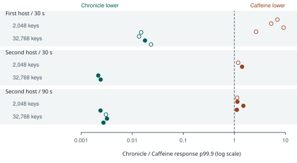
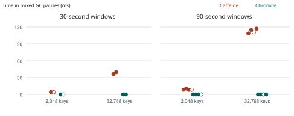
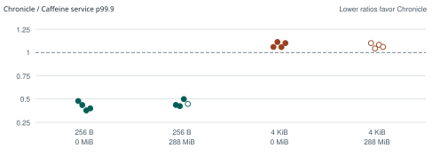
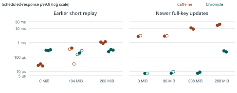

# TailCache: A Study of Tail Latency in On-Heap and Off-Heap Java Caches

22 November 2026

## Abstract

A Java cache can return a hit quickly and still leave a request waiting through a garbage collection pause. We timed requests from dispatch and from scheduled arrival for two caches that handle reads differently: Caffeine returns a reference to a value on the Java heap, while an ordinary read from in-memory Chronicle Map copies an off-heap value into a new array.

On two machines, changing which keys could receive writes reversed the ranking at the 99.9th percentile (p99.9) of response time. Both caches held 32,768 entries of 4 KiB, with 5% writes, 50,000 intended arrivals/s, and no added application data. Caffeine had the lower response p99.9 when writes were confined to 2,048 keys; Chronicle had the lower response p99.9 when writes could reach any key. In the latter case, the 30-second runs on the second machine gave 3.09-3.65 ms for Caffeine and 7.48-7.90 µs for Chronicle. G1 mixed collections accounted for most of Caffeine's additional pause time.

Timing back-to-back operations gave a different picture. Across 48 pairs of runs, Chronicle had the lower service p99 and p99.9 for 256 B values, and Caffeine for 4 KiB values. Timed writes included the cost of constructing a fresh value. Timing reads alone gave the same p99.9 ranking at every heap pressure and write rate tested. An engineer choosing between these configurations therefore needs to know which keys get overwritten as well as how large the values are and when the latency clock starts.

## 1. Introduction

Consider a request that reads a byte array already in a cache. Caffeine keeps the array on the Java heap and returns a reference to it. The array stays live while the cache retains it; Caffeine can evict entries when it reaches a configured size [1]. Chronicle Map keeps entries outside the Java heap and supports both in-memory and file-backed storage [2]. With the in-memory store and ordinary read API used here, a hit copies the stored bytes into a new Java array.

That copy contributes to the time spent serving a read. A garbage collection pause can affect the same request in a different way: if it arrives while the worker is stopped, some of its delay occurs before the cache call begins. We compare size-bounded Caffeine and in-memory Chronicle Map on the same byte arrays and workloads, measuring both the operation itself and the time from scheduled arrival to completion.

We ask whether retaining more application data on the heap reverses the service-latency ranking at p99 or p99.9 (**RQ1**) and whether changing the value size reverses it (**RQ2**). For scheduled arrivals, we ask a different question: if the arrival rate and write fraction stay fixed, does it matter which keys receive the writes (**RQ3**)? We repeated this last comparison on a second machine with different hardware and a different runtime.

## 2. Related work

Prior work has addressed both sides of the cache placement decision. Prioritized garbage collection lets the runtime balance cache retention against collection costs [3]. A practitioner comparison of Caffeine and OHC found that cache size and collection costs can change which placement is preferable [4]. TeraCache and TeraHeap address serialization and memory pressure in managed analytics [5] [6]. Yak manages control objects with a generational collector and data objects in regions [7]; NG2C groups objects by expected lifetime to reduce promotion work [8]. We follow collector studies that report application latency alongside GC measurements [9]. Our question concerns two existing cache configurations: at matched fresh-write demand, does changing the set of eligible write keys change the ranking on both hosts?

A slow component response can affect an entire service [10], and hardware, the operating system, and the application can all contribute to the tail [11]. The arrival process also matters. Schroeder et al. distinguish workloads with independently scheduled arrivals from those in which completion triggers the next request [12]. If a worker stalls in a completion-driven test, requests that would otherwise arrive during the stall never enter the sample. Inferring scheduled-response latency from that sample risks coordinated omission [13]. We keep the intended arrival time of each request so that a stall counts against requests already due.

Georges et al. distinguish variation within a JVM invocation from variation across invocations [14]. A fixed warmup period alone does not establish steady state, as Barrett et al. and Traini et al. show [15] [16]. We therefore report percentiles for individual JVM runs (forks), retain compilation warnings, and check whether comparisons that exclude warned pairs point in the same direction.

## 3. Methods

### 3.1 Cache semantics and timing

We ran Caffeine 3.2.4 and Chronicle Map 2026.1 on Java 21 and recorded latency with HdrHistogram 2.2.2 [13]. Chronicle used its ordinary get API [17]. Each cache started with 32,768 resident entries. Every read was a hit, and every measured overwrite allocated a fresh immutable byte array. A single worker issued cache operations; JVM and library helper threads could also run. The libraries differ in layout and maintenance as well as in where they store values.

For service latency, the clock starts just before the worker dispatches an operation and stops just after it consumes a result byte for the checksum. An overwrite therefore includes allocating and filling the array. We record reads and updates both together and separately. In the saturated benchmark the worker starts its next operation as soon as it finishes the last one. In the scheduled benchmark, response time ends at the same checksum boundary but starts when the request was due. At 50,000 arrivals/s a request is due every 20 µs. If the worker stops for GC, overdue requests wait their turn and run in order when it resumes. The p99.9 marks roughly the boundary of the slowest one in 1,000 observations.

### 3.2 Locality intervention and replication

For a given seed, both backends received the same sequence of reads and writes. Reads sampled all 32,768 keys uniformly. Writes either targeted a fixed subset of 2,048 keys or could reach all 32,768. We held the other settings fixed: 4 KiB values, 5% nominal writes, G1, a 512 MiB fixed heap, no added application data, and 32 MiB/s of offered background allocation. At about 2,500 writes/s, the expected interval between overwrites of a given eligible key is 0.82 s for the smaller set and 13.1 s for the full set. These are workload averages; they do not measure the lifetime of an individual value.

The first Linux host had an Intel Core i7-8750H (6 cores, 12 logical CPUs). We ran two seeds, then repeated each seed with the backend order reversed. On the second Linux host, an AMD Ryzen 7 5800X (8 cores, 16 logical CPUs), Temurin 21.0.13+9 ran with a 12-CPU JVM budget. We used two fresh seeds for the 30-second replication and four further seeds for 90-second windows. On both hosts the locality tests used 120 seconds of warmup and four seconds of conditioning with zero priming. Hardware, JVM build, seeds, and window length differ across cohorts, so we report the pairs within each cohort and do not pool effect sizes.

### 3.3 Pressure, write-rate, and quality checks

On the second host we ran four saturated pairs at each combination of value size (256 B or 4 KiB), added application data (0 or 288 MiB), and nominal write fraction (1%, 5%, or 10%). The added data, or ballast, consists of objects held by strong references independently of the cache. At zero ballast the cache and temporary allocations still occupy memory. We fixed the offered rate of background allocation (churn) and recorded any shortfall. Because the worker ran continuously, the backends could finish different numbers of operations. A separate paced sweep used 4 KiB values, all 32,768 eligible keys, zero added ballast, and four seed pairs per setting; writes ranged from 0.5% to 2%.

A pair consists of two JVM runs with the same workload and seed, one per backend. We report fork-level quantiles and descriptive ranges, retaining warnings for compilation, external CPU activity, and dropped churn. Before the 48-pair saturated matrix, a native observer handoff on the second host improved attribution of activity to individual processes. We reran one eligible pair flagged for external noise. The first-pass results retain the original pair; only the separate warning-free sensitivity analysis uses the rerun.

## 4. Results

### 4.1 Write locality reverses scheduled-response p99.9 on two hosts

Figure 1 shows all 20 paired comparisons. In every pair with 2,048 eligible write keys, Caffeine had the lower response p99.9. Every pair with 32,768 eligible keys favored Chronicle. The reversal held when we switched backend order on the first host and when we used fresh seeds and extended the measurement window to 90 seconds on the second.

**Figure 1.** A dot represents a pair with the same seed and run block. Ratios below 1 favor Chronicle. Filled dots mark pairs without recorded warnings; open dots show pairs retained despite a warning.

| Host and window | Write keys | Caffeine p99.9 | Chronicle p99.9 | Warning-free pairs |
| --- | ---: | ---: | ---: | ---: |
| First, 30 s | 2,048 | 24.75-28.06 µs | 74.82-244.10 µs | 0/4 |
| First, 30 s | 32,768 | 8.90-9.70 ms | 125.38-226.56 µs | 1/4 |
| Second, 30 s | 2,048 | 6.42-6.53 µs | 7.61-9.26 µs | 1/2 |
| Second, 30 s | 32,768 | 3.09-3.65 ms | 7.48-7.90 µs | 2/2 |
| Second, 90 s | 2,048 | 6.44-8.13 µs | 7.24-9.66 µs | 3/4 |
| Second, 90 s | 32,768 | 2.90-3.20 ms | 7.50-9.43 µs | 3/4 |

On the second host, when writes could reach any key, Caffeine's service p99.9 was 6.36-7.42 µs in the 30-second runs. Measuring from the scheduled arrival put its response p99.9 above 3 ms. Chronicle's response p99.9 stayed near 8 µs. Most Caffeine calls still completed quickly once dispatched; the gap between the two timing measures is consistent with requests waiting for the worker.

Over those measurement windows, Caffeine's GC pauses overlapped 8.21-9.91 ms with concentrated writes and 59.57-65.13 ms when writes could reach any key. Chronicle's overlap stayed within 12.79-13.15 ms. Changing the eligible keys did not change measured allocation per operation within a backend and seed.

The pause records place most of Caffeine's additional pause time in G1 mixed collections (Figure 2). With the broader write set, time in mixed collections rose from 3.90-4.03 ms to 36.14-39.68 ms in the 30-second windows and from 8.27-10.47 ms to 108.53-117.04 ms in the 90-second windows. Neither backend recorded a full collection in these locality tests.

**Figure 2.** Each point represents one fork; the panels share a scale. Open marks indicate a recorded warning in the pair. Chronicle recorded no time in mixed collections in these runs.

A possible explanation is the interval between overwrites. A value stays live while Caffeine holds it. If a key is overwritten less often, its value has more time to reach the old generation before a write makes it eligible for reclamation. G1 mixed collections collect young regions together with selected old regions [18].

The second-host age logs are consistent with that account. At every recorded age-table update in the 30- and 90-second measurement windows, Caffeine's tenuring threshold was 15 for the 2,048-key set and 1 for the 32,768-key set. Chronicle's stayed at 15. G1 calculates this threshold from the age table and the desired survivor-space size [19]. In the 90-second Caffeine runs, the median volume of age-one objects rose from 8.5 MiB to 19.8-20.0 MiB, while the median desired survivor size fell from 19.5 MiB to 10.0 MiB. The logs aggregate objects across the heap: they cannot identify which cache values were promoted or how many bytes those values occupied. Changing the write set may also change cache policy work.

The ranking at p99.9 does not carry over uniformly to more extreme percentiles. At scheduled-response p99.99 and p99.999, Chronicle led in three of the four 90-second pairs for each write set. The two exceptions included Chronicle completion gaps of 18.783 ms and 19.730 ms; neither coincided with a logged GC pause or JVM safepoint. In a 30-second fork, roughly 15 operations lie beyond the nominal p99.999 rank. Several of them can reflect the same stall.

### 4.2 Payload changes the saturated-service ranking

Value size determined the observed ranking for back-to-back operations. At combined service p99 and p99.9, Chronicle led for 256 B values (24/24 pairs) and Caffeine for 4 KiB values (24/24). This held at both pressure endpoints and all three write fractions. The same backend had the lower read-only p99.9 in every first-pass pair. Adding heap pressure did not produce a robust crossover at either service percentile.

Of the 48 first-pass pairs, 36 had no recorded warnings. Substituting the eligible external-noise rerun in the sensitivity analysis brought that count to 37 without changing the ranking in its cell. At 4 KiB with 288 MiB of ballast, every Caffeine run at 5% or 10% writes missed some background allocation: 0.049-0.115% of the churn bytes offered during measurement. There are no warning-free pairs for those settings.

**Figure 3.** First-pass pairs at 5% writes. Each point is a Chronicle-to-Caffeine p99.9 ratio. The dashed line marks equal latency. Open marks indicate a recorded warning in either run of the pair.

For 5% writes and zero added heap data, the table gives the median of four fork-level percentiles in each column. Separating reads from updates shows where the two caches differed:

| Value | Cache | Read p50 | Read p99.9 | Update p50 | Update p99.9 |
| --- | --- | ---: | ---: | ---: | ---: |
| 256 B | Caffeine | 0.10 µs | 1.80 µs | 0.43 µs | 1.75 µs |
| 256 B | Chronicle | 0.10 µs | 0.65 µs | 0.58 µs | 1.52 µs |
| 4 KiB | Caffeine | 0.13 µs | 1.36 µs | 5.46 µs | 10.61 µs |
| 4 KiB | Chronicle | 0.59 µs | 2.08 µs | 6.22 µs | 11.60 µs |

At 256 B, median read times were similar, but Chronicle had the lower read p99.9. Earlier experiments changed the small-value ranking by varying Caffeine policy and JMH measurement settings. At 4 KiB, the worker allocated about 4,122 bytes per operation with Chronicle, averaged over reads and writes, versus about 206 with Caffeine. That difference and Chronicle's higher read p50 are consistent with the cost of allocating and filling a larger array on an ordinary read.

For 4 KiB values, updates made up 90.2-99.6% of observations in bins strictly above the combined service p99.9 across first-pass forks. Both backends ran the same fresh-value generator inside each timed update. We can therefore report the cost of the workload as run, but cannot apportion its tail among value construction, cache access, and policy work.

### 4.3 A write-rate bracket and the limits of pause-based prediction

In the paced sweep on the second host, Caffeine had the lower response p99.9 in every pair at 1.25% writes, and Chronicle in every pair at 1.5%. All eight pairs at those settings were warning-free. At 0.75% and 1%, the pairs disagreed. The two unanimous settings bracket a change in ranking for this workload; they do not establish a general write-rate threshold. In three of four Caffeine forks at 1.5%, GC pauses totaled less than 30 ms in a 30-second window, yet Chronicle still led. Near the bracket, the length of each pause, the arrivals it overlaps, and the backlog it leaves can matter. Earlier forecasts on the first host also missed the ranking near the low-write boundary.

A first-host discovery run illustrates how service p99.9 can stay low despite long GC pauses. Despite substantial wall time in GC, large pauses overlapped only 312 of 28.5 million timed calls. Under fixed arrivals, one such pause can delay a succession of requests as the worker clears its backlog. Models using pauses measured during the run can help reconstruct the response tail. In earlier held-out evaluations they still made errors near the boundary and predicted the faster backend no better than a comparison of total GC pause time.

### 4.4 How the newer measurements change the earlier pressure result

Our first pressure experiment used a short trace that repeated about every 0.8 s and wrote to roughly 1,940 keys per seed. With 4 KiB values, Caffeine had the lower response p99.9 at 0 MiB of added data and Chronicle at 208 MiB. At 104 MiB the pairs disagreed.

That pressure bracket did not carry over to the second host. There we kept writes at 5% but allowed updates across all 32,768 keys. Chronicle led at 0, 96, 208, and 288 MiB in both seeds (Figure 4). The host and workload changed together in this comparison. Section 4.1 isolates the eligible-key intervention within a host: changing the write set alone was sufficient to reverse the response ranking at zero ballast.

**Figure 4.** Both panels use the same latency scale. The earlier panel shows the primary short-replay runs. The newer panel shows the second-host full-key runs. Open marks indicate pairs with recorded warnings. The simultaneous changes in workload and host limit direct causal comparison between panels.

In the short-replay experiment, Chronicle already had the lower response p99.99 and p99.999 at zero ballast. The full-key pressure experiment on the second host gave the same baseline ranking. The exceptions in the 90-second locality runs (Section 4.1) show why we do not extend that observation to every run at the extreme tail.

## 5. Limitations and implications

The response reversal replicated on two hosts with one cache worker, G1, two specific libraries, a bounded synthetic workload, and fixed arrival intervals. Enlarging the eligible write set changes several things at once: how often a key is overwritten, where writes land, and what work the cache policy may do. The experiment identifies a workload condition under which the ranking changes. It cannot isolate an individual JVM mechanism or predict a production service-level agreement. With few seed pairs and potentially many delayed requests from a single stall, we report descriptive comparisons.

Even a warning-free run can contain an unexplained stall. In the 1.25% write-rate sweep, one Chronicle read took 18.12 ms without overlapping a logged GC pause or safepoint. The whole-host observer samples at 1 Hz and can miss a brief delay on the benchmark thread. We could not explain this stall or the two gaps in the 90-second locality tests. All three remain in their original cohorts.

The original pressure campaign did not meet all of its planned acceptance criteria. The supplementary evidence gives its conditional results and compares JMH sampling with timing every operation. The small-value service ranking was sensitive to both measurement settings and cache configuration.

Our main workloads measure hits and overwrites in memory. They do not establish the cost of misses, persisted access, skewed reads, or competition among workers sharing a cache. Earlier buffer-reuse runs also gave the caller different ownership of the returned value. Memory use depends on what is counted: in the midpoint follow-up Chronicle retained less data on the Java heap but had higher sampled resident set size (RSS). We have not compared the two configurations at equal total memory.

For an application with small values, the first comparison should use the cache policy the application actually needs. For larger values under scheduled arrivals, the overwrite pattern deserves particular attention. A benchmark that reports only the fraction of writes cannot tell a reader whether those writes repeatedly replace the same few values or are spread across the cache. Report the eligible write set and arrival rate alongside the write fraction, and say whether latency includes time spent waiting for the worker.

## 6. Data and code availability

The second-host archive includes raw HDR histograms and bins, GC and age logs, measurement windows, and frozen schedules. From 252 research runs, two retry runs, 36 diagnostic runs, and 60 timing controls, the offline verifier reconstructs the percentile tables, conclusions at individual settings, and retry comparisons.

The [versioned archive and instructions](https://github.com/Enixes/TailCache/tree/4c3ab6794643febf676d91446f80b9724517ff74/docs/second-host-20261120/archive) identify the source commits and evidence checksums. The [current verifier](https://github.com/Enixes/TailCache/blob/codex/tailcache-portability/scripts/tailcache_verify_archive.py) supports offline reconstruction on Linux and macOS with Python 3.10 or later. The [timing and G1 audit](https://github.com/Enixes/TailCache/blob/codex/tailcache-preprint/docs/preprint/timing-audit.json) provides the per-fork results behind the upper-tail, tenuring, and stall analyses.

The [first-host mechanism dataset](https://github.com/Enixes/TailCache/tree/5772fb212692244a29b6ab61d416340db600f0c8/docs/mechanism) provides the first-host measurements and paired comparisons. The [TailCache repository](https://github.com/Enixes/TailCache) provides the benchmark and analysis code. The [claim map](https://github.com/Enixes/TailCache/blob/codex/tailcache-preprint/docs/preprint/CLAIMS.md) identifies the inputs behind the figures. The [interactive companion](https://github.com/Enixes/TailCache/blob/codex/tailcache-preprint/output/html/tailcache-preprint-reader.html) exposes the paired measurements and provides filters for latency, payload, and workload. Source collection inventories and launcher logs remain on the respective hosts.

### AI assistance

We used an AI assistant to help implement the benchmark and analysis tooling, examine the evidence, and edit the manuscript.

## 7. Conclusion

In back-to-back operations, Chronicle had the lower combined service p99 and p99.9 for 256 B values; Caffeine had the lower values for 4 KiB. Timing reads alone preserved that p99.9 ranking, and we found no robust service reversal with added heap pressure. Once the clock included waiting from a scheduled arrival, the answer for 4 KiB values depended on which keys were overwritten. At 5% writes and zero added application pressure, Caffeine had the lower response p99.9 for a small write set and Chronicle for writes spread across the cache. Both machines reproduced the reversal. For these configurations, a service-time measurement alone would have missed it.

### Future work

We plan to test whether a cache recommendation can be made before running an application's benchmark. A model could use representative instances of the application's plain old Java object (POJO) to estimate encoded size and read allocation, including for strings, decimal values, and nested records. It would also need the latency measure of interest, the arrival rate, the write fraction and distribution of writes across keys, and the heap and collector settings. We would evaluate service and scheduled-response predictions separately on held-out object shapes and workloads, allowing the model to return an inconclusive result.

One planned experiment would compare Caffeine reads with ordinary Chronicle Map reads and Chronicle Map's `getUsing()` [17]. An application that consumes a value immediately can use a different ownership contract from one that keeps it across later reads. Measuring both cases would show what buffer reuse saves and what a separate copy costs when the caller needs to retain the value.

To separate the costs within an overwrite, we would time fresh-value construction and the cache API call independently while keeping both in the scheduled-response measurement. Repeating the eligible-key experiment with another collector would test the dependence of the reversal on G1.

For a comparison of in-memory and persisted Chronicle Map, we would measure opening the persisted map and first access to its pages separately from warm access. In the warm test we would touch the mapped pages before measurement and record the filesystem, mount, and storage settings. Another comparison would hold the arrival rate fixed and test 5% and 10% writes at both eligible-key set sizes to see whether the reversal persists under heavier write traffic.

## References

[1] Caffeine project. Caffeine cache library. [Project documentation](https://github.com/ben-manes/caffeine#cache).

[2] OpenHFT. Chronicle Map features. [Project documentation](https://github.com/OpenHFT/Chronicle-Map/blob/ea/docs/CM_Features.adoc).

[3] D. Nunez, S. Z. Guyer, and E. D. Berger. Prioritized Garbage Collection: Explicit GC Support for Software Caches. OOPSLA, 2016. [DOI](https://doi.org/10.1145/2983990.2984028).

[4] M. Knasiecki. GC, hands off my data! Allegro engineering blog, 2022. [Article](https://blog.allegro.tech/2022/06/gc-hands-off-my-data.html).

[5] I. G. Kolokasis et al. Say Goodbye to Off-heap Caches! On-heap Caches Using Memory-Mapped I/O. HotStorage, 2020. [USENIX](https://www.usenix.org/conference/hotstorage20/presentation/kolokasis).

[6] I. G. Kolokasis et al. TeraHeap: Reducing Memory Pressure in Managed Big Data Frameworks. ASPLOS, 2023. [DOI](https://doi.org/10.1145/3582016.3582045).

[7] K. Nguyen et al. Yak: A High-Performance Big-Data-Friendly Garbage Collector. OSDI, 2016. [USENIX](https://www.usenix.org/conference/osdi16/technical-sessions/presentation/nguyen).

[8] R. Bruno, L. P. Oliveira, and P. Ferreira. NG2C: Pretenuring Garbage Collection with Dynamic Generations for HotSpot Big Data Applications. ISMM, 2017. [DOI](https://doi.org/10.1145/3092255.3092272).

[9] Z. Cai, S. M. Blackburn, M. D. Bond, and M. Maas. Distilling the Real Cost of Production Garbage Collectors. ISPASS, 2022. [DOI](https://doi.org/10.1109/ISPASS55109.2022.00005).

[10] J. Dean and L. A. Barroso. The Tail at Scale. Communications of the ACM, 2013. [DOI](https://doi.org/10.1145/2408776.2408794).

[11] J. Li, N. K. Sharma, D. R. K. Ports, and S. D. Gribble. Tales of the Tail: Hardware, OS, and Application-level Sources of Tail Latency. SoCC, 2014. [Paper](https://courses.cs.washington.edu/courses/cse452/23wi/papers/sharma-et-al-tales-of-the-tail.pdf).

[12] B. Schroeder, A. Wierman, and M. Harchol-Balter. Open Versus Closed: A Cautionary Tale. NSDI, 2006. [USENIX](https://www.usenix.org/conference/nsdi-06/open-versus-closed-cautionary-tale).

[13] G. Tene and HdrHistogram contributors. HdrHistogram 2.2.2. [Versioned recording and correction API](https://github.com/HdrHistogram/HdrHistogram/blob/HdrHistogram-2.2.2/src/main/java/org/HdrHistogram/AbstractHistogram.java).

[14] A. Georges, D. Buytaert, and L. Eeckhout. Statistically Rigorous Java Performance Evaluation. OOPSLA, 2007. [Paper](https://users.elis.ugent.be/~leeckhou/papers/oopsla07-stat.pdf).

[15] E. Barrett, C. F. Bolz-Tereick, R. Killick, S. Mount, and L. Tratt. Virtual Machine Warmup Blows Hot and Cold. PACMPL (OOPSLA), 2017. [DOI](https://doi.org/10.1145/3133876).

[16] L. Traini, V. Cortellessa, D. Di Pompeo, and M. Tucci. Towards effective assessment of steady state performance in Java software: are we there yet? Empirical Software Engineering, 2023. [DOI](https://doi.org/10.1007/s10664-022-10247-x).

[17] OpenHFT. ChronicleMap interface, 2026.1. [Versioned API source](https://github.com/OpenHFT/Chronicle-Map/blob/chronicle-map-2026.1/src/main/java/net/openhft/chronicle/map/ChronicleMap.java).

[18] Oracle. Garbage-First (G1) Garbage Collector. Java 21 Garbage Collection Tuning Guide. [Garbage collection cycle](https://docs.oracle.com/en/java/javase/21/gctuning/garbage-first-g1-garbage-collector1.html).

[19] OpenJDK. HotSpot age table and tenuring threshold. [JDK 21 update source](https://github.com/openjdk/jdk21u/blob/master/src/hotspot/share/gc/shared/ageTable.cpp).
